# Jarkom-Modul-3-2026-K-11

Laporan Praktikum Modul 3: Komunikasi Data & Jaringan Komputer 2026
**Curtain Protocol: Shibuya Incident, Pemulihan Jaringan dan Layanan Jujutsu High**

Anggota Kelompok K-11:
- Husam Danish (5027251060) - 1-10
- Hasheemi Rafsanjani (5027251015) - 11-20


Konvensi: prefix jaringan internal `10.69.x.x`, netmask `/24`, domain `jujutsu.K11.com`. Setiap blok perintah diberi keterangan **dijalankan di `<node>`**, node tempat perintah itu dieksekusi.

## Soal 1: Konektivitas Dasar dan Routing `jichi`

**Tujuan.** Memulihkan konektivitas antar-zona. `jichi` berperan sebagai router utama: antarmuka `eth0` memperoleh WAN dari NAT, sedangkan `eth1`–`eth4` menjadi gateway **Network 1–4**. IPv4 forwarding dan source NAT (masquerade) diaktifkan, lalu setiap host infrastruktur diberi IP statis sesuai rancangan.

**Pemetaan interface `jichi`:**

| Interface | Peran | Alamat |
|-----------|-------|--------|
| `eth0`   | WAN (DHCP dari NAT1) | `192.168.122.207/24` (nilai bisa berubah tiap boot) |
| `eth1`   | Gateway Network 1 (DMZ) | `10.69.1.1/24` |
| `eth2`   | Gateway Network 2 (Klien Divisi A) | `10.69.2.1/24` |
| `eth3`   | Gateway Network 3 (Klien Divisi B) | `10.69.3.1/24` |
| `eth4`   | Gateway Network 4 (Data Center) | `10.69.4.1/24` |

### 1.1 Konfigurasi Interface `jichi`

Konfigurasi `/etc/network/interfaces` pada `jichi`, **dijalankan di `jichi`**:

```sh
cat /etc/network/interfaces
```


> **[Screenshot: `/etc/network/interfaces` pada `jichi`]**

### 1.2 Aktifkan IPv4 Forwarding dan Source NAT

Diaktifkan melalui script `/root/01-setup-routing.sh` (**dijalankan di `jichi`**):

```sh
....
iptables -t nat -F POSTROUTING 2>/dev/null || true
iptables -F FORWARD 2>/dev/null || true

iptables -t nat -A POSTROUTING -o eth0 -j MASQUERADE
for i in 1 2 3 4; do
	iptables -A FORWARD -i eth$i -o eth0 -j ACCEPT
done
for i in 1 2 3 4; do
	iptables -A FORWARD -i eth0 -o eth$i -m state --state ESTABLISHED,RELATED -j ACCEPT
done
....
```

Efek yang dihasilkan pada `jichi`, **dijalankan di `jichi`** (perhatikan aturan balik dibuat untuk **setiap** `eth1`–`eth4`, bukan hanya `eth1`):

```sh
sysctl -w net.ipv4.ip_forward=1
iptables -t nat -A POSTROUTING -o eth0 -j MASQUERADE
iptables -A FORWARD -i eth1 -o eth0 -j ACCEPT
iptables -A FORWARD -i eth2 -o eth0 -j ACCEPT
iptables -A FORWARD -i eth3 -o eth0 -j ACCEPT
iptables -A FORWARD -i eth4 -o eth0 -j ACCEPT
iptables -A FORWARD -i eth0 -o eth1 -m state --state ESTABLISHED,RELATED -j ACCEPT
iptables -A FORWARD -i eth0 -o eth2 -m state --state ESTABLISHED,RELATED -j ACCEPT
iptables -A FORWARD -i eth0 -o eth3 -m state --state ESTABLISHED,RELATED -j ACCEPT
iptables -A FORWARD -i eth0 -o eth4 -m state --state ESTABLISHED,RELATED -j ACCEPT
```

Hasil `ip addr show` pada `jichi` (semua interface naik dengan alamat benar):


IPv4 forwarding aktif, **dijalankan di `jichi`**:
```sh
cat /proc/sys/net/ipv4/ip_forward
```


Aturan masquerade pada tabel NAT, **dijalankan di `jichi`**:
```sh
iptables -t nat -L POSTROUTING -v -n
```


### 1.3 Verifikasi Gateway (`jichi` → NAT)

`jichi` dapat menjangkau gateway NAT `192.168.122.1`, **dijalankan di `jichi`**:
```sh
ping -c3 192.168.122.1
```


### 1.4 Verifikasi IPv4 Forwarding

Forwarding diuji dari host infrastruktur menuju gateway network-nya. Contoh pada `tengen` (Network 4), **dijalankan di `tengen`**:
```sh
ping -c3 10.69.4.1
```

Dan dari host klien/infrastruktur melalui masquerade `jichi`, contoh `tengen` (Network 4), **dijalankan di `tengen`**:

```sh
ping -c3 1.1.1.1
```


Pada `utahime` (Network 1), **dijalankan di `utahime`**:

```sh
ping -c3 10.69.1.1
ping -c3 1.1.1.1
```


> **[Screenshot: `ping -c3 10.69.1.1` dari `utahime` (Network 1)]**


> **[Screenshot: `ping -c3 1.1.1.1` dari `utahime` (Network 1)]**

### 1.5 Verifikasi Akses Eksternal (Masquerading)

Akses eksternal dibuktikan dari `jichi` sendiri, **dijalankan di `jichi`**:
```sh
ping -c3 192.168.122.1
ping -c3 8.8.8.8
```


### 1.6 IP Statis Host Infrastruktur

Selain `jichi`, host infrastruktur diberi IP statis. Disimpan sebagai script di `/root` tiap node. Rancangan:

| Network | Host | Alamat | Gateway |
|---------|------|--------|---------|
| 1 | `utahime` (DNS master) | `10.69.1.2/24` | `10.69.1.1` |
| 1 | `shoko` (DNS slave) | `10.69.1.3/24` | `10.69.1.1` |
| 1 | `gojo` (reverse proxy) | `10.69.1.4/24` | `10.69.1.1` |
| 4 | `geto` (internal LB) | `10.69.4.2/24` | `10.69.4.1` |
| 4 | `maki` (worker web) | `10.69.4.3/24` | `10.69.4.1` |
| 4 | `panda` (worker web) | `10.69.4.4/24` | `10.69.4.1` |
| 4 | `nanami` (worker API) | `10.69.4.5/24` | `10.69.4.1` |
| 4 | `todo` (worker API) | `10.69.4.6/24` | `10.69.4.1` |
| 4 | `kirara` (worker API cadangan) | `10.69.4.7/24` | `10.69.4.1` |
| 4 | `yaga` (DB master) | `10.69.4.8/24` | `10.69.4.1` |
| 4 | `inumaki` (DB slave) | `10.69.4.9/24` | `10.69.4.1` |
| 4 | `tengen` (DHCP server) | `10.69.4.10/24` | `10.69.4.1` |

Contoh bukti IP statis pada host Network 1 (`utahime`) dan host Network 4 (`tengen`), **dijalankan di `utahime` dan `tengen`**:

> **Catatan.** Script `common/01-static-ip.sh` juga menambahkan baris hook `up bash /root/tengen.sh` pada `/etc/network/interfaces` milik `tengen` — prasyarat autostart DHCP server (Soal 10).

```sh
ip -br addr
```


> **[Screenshot: `ip -br addr` pada `utahime` (Network 1)]**


> **[Screenshot: `ip -br addr` pada `tengen` (Network 4)]**

---

## Soal 2: DHCP Server `tengen`

**Tujuan.** `tengen` (Data Center, `10.69.4.10`) menjadi DHCP server. Network 4 dideklarasikan sebagai **subnet lokal tanpa pool dinamis**, sedangkan scope untuk **Network 2** dan **Network 3** disiapkan agar permintaan dari kedua subnet dapat dilayani. Service harus aktif tanpa error **“No subnet declaration”**.

**Dijalankan di `tengen`.**

**Langkah.** Install `isc-dhcp-server`, set `INTERFACESv4="eth0"`, tulis `/etc/dhcp/dhcpd.conf` berisi tiga deklarasi `subnet` (N4 lokal, N2 dan N3 untuk relay), lalu validasi dan restart service. Disimpan sebagai script `/root/02-dhcp-server.sh`:

```sh
cat /root/02-dhcp-server.sh
```

Isi `/etc/dhcp/dhcpd.conf`, **dijalankan di `tengen`**:

```sh
cat /etc/dhcp/dhcpd.conf
```


> **[Screenshot: `/etc/dhcp/dhcpd.conf` pada `tengen`]**
---

**Langkah.** Install `isc-dhcp-relay`, set `SERVERS="10.69.4.10"` dan `INTERFACES="eth2 eth3 eth4"` (`eth4` = sisi server `tengen`, tanpa ini balasan DHCP tak kembali), lalu restart service. Disimpan sebagai script `/root/03-dhcp-relay.sh`:

```sh
cat /root/03-dhcp-relay.sh
```


Isi `/etc/default/isc-dhcp-relay`, **dijalankan di `jichi`**:
```sh
cat /etc/default/isc-dhcp-relay
```


> **[Screenshot: `/etc/default/isc-dhcp-relay` pada `jichi`]**

Proses `dhcrelay` aktif pada `eth2`, `eth3`, & `eth4`, **dijalankan di `jichi`**:

```sh
ps -ef | grep dhcrelay
```


> **[Screenshot: proses `dhcrelay` berjalan]**

Bukti relay berjalan (client N2 mengirim DISCOVER), **dijalankan di `jichi`**:

```sh
tcpdump -i eth2 -n port 67 or port 68
```


> **[Screenshot: `tcpdump` pada `jichi` (eth2), `DHCPDISCOVER` dari client Network 2]**

Client Network 2 tidak memperoleh lease karena pool DHCP belum dikonfigurasi (akan diisi pada Soal 4–5). Bukti pada klien Divisi A (N2) dan Divisi B (N3) saat ini:

Klien N2 (**dijalankan di klien N2, mis. `itadori`**):


Klien N3 (**dijalankan di klien N3, mis. `ino`**):


**Bukti relay berhasil meneruskan ke server DHCP (`10.69.4.10`), dijalankan di `tengen`**

```sh
tcpdump -i eth0 -n port 67 -vv
```

> **[Screenshot: `tcpdump` pada `tengen` (eth0), `DHCPDISCOVER` dari subnet N2/N3 dengan `giaddr` = `10.69.2.1` (N2) dan `10.69.3.1` (N3)]**

Pada sisi `tengen`, terlihat `DHCPDISCOVER` yang diteruskan oleh `dhcrelay` dari `jichi` (`10.69.4.1`), dengan `Gateway-IP` (giaddr) sesuai subnet client. Tanpa pool DHCP yang diaktifkan, dhcpd tidak mengirim `DHCPOFFER`. Relay berjalan sesuai konfigurasi. Hanya `pool` untuk N2 dan N3 yang belum ditambahkan (akan dilakukan pada Soal 4–5).

---

## Soal 4: DHCP Pool & Class Network 2

**Tujuan.** Membagi pool N2: Pool 1 (`10.69.2.10–10.69.2.35`) untuk `itadori`, `fushiguro`; Pool 2 (`10.69.2.70–10.69.2.95`) untuk `zenin`, `okkotsu`. Rentang `10.69.2.36–10.69.2.69` dilarang. Pisahkan menggunakan **DHCP class** berdasarkan MAC.

Script: `/root/04-dhcp-n2.sh` (disimpan di `script/tengen/04-dhcp-n2.sh`), **dijalankan di `tengen`**.

> **Catatan.** Blok `subnet` N2/N3 sudah dideklarasikan pada Soal 2; script Soal 4–5 menambahkan `class`/`pool` pada berkas `dhcpd.conf` yang sama, sehingga berkas akhir memuat deklarasi `subnet` (Soal 2) sekaligus `class`/`pool` (Soal 4–5).
>
> **Catatan (peringatan `overlaps`).** Karena `subnet` N2/N3 dideklarasikan dua kali (Soal 2 lalu Soal 4–5), `dhcpd` menulis `Warning: subnet 10.69.2.0/24 overlaps subnet 10.69.2.0/24` saat start. Ini **tidak fatal** — lease tetap dibagikan. Deklarasi N2/N3 pada Soal 2 wajib ada sesuai permintaan soal, jadi blok tersebut tidak dihapus.
>
> **Catatan (MAC hardcode).** Nilai `subclass`/`host` di-hardcode dari topologi saat ini. Bila MAC NIC node berubah setelah rebuild GNS3, perbarui daftar MAC di `04-dhcp-n2.sh`/`05-dhcp-n3.sh` agar pool & fixed address tetap cocok.

Konfigurasi `/etc/dhcp/dhcpd.conf` (bagian N2), **dijalankan di `tengen`**:

```sh
cat /etc/dhcp/dhcpd.conf
```


> **[Screenshot: konfigurasi pool & class N2 pada `tengen`]**

Validasi, **dijalankan di `tengen`**:
```sh
dhcpd -t -cf /etc/dhcp/dhcpd.conf
service isc-dhcp-server restart
service isc-dhcp-server status
```


> **[Screenshot: validasi + status `isc-dhcp-server` setelah Soal 4]**

Verifikasi client N2 memperoleh lease sesuai pool, **dijalankan di tiap klien N2** (`itadori`, `fushiguro`, `zenin`, `okkotsu`):

```sh
# itadori & fushiguro -> 10.69.2.10–.35; zenin & okkotsu -> 10.69.2.70–.95
ip -br addr
```

`itadori`


`fushiguro`


`zenin`


`okkotsu`


> **[Screenshot: `ip -br addr` client N2]**

> **Catatan (perbaikan).** Nilai `subclass` wajib diawali `1:` (tipe hardware Ethernet). Client mengirim DHCP **Client-ID** `ether 02:42:...`, yaitu byte `01:02:42:...`, jadi penulisannya `subclass "pool1-n2" 1:02:42:47:5c:e2:00;`. Tanpa prefix `1:`, kelas tak cocok (`pick-first-value` mengembalikan Client-ID 7-byte), `dhcpd -d` mencatat `network 10.69.2.0/24: no free leases`, dan client tak menerima lease.

Jika klien belum otomatis memperoleh IP, jalankan di klien tersebut (**dijalankan di klien N2/N3**):
```sh
udhcpc -i eth0
```

---

## Soal 5: Network 3 (Short & Long Lease)

**Tujuan.** N3: `ino`, `kusakabe` short lease **1800s** (pool `.3.10–.3.89`); `miwa` long lease **43200s** (pool `.3.100–.3.199`). Atur `default-lease-time`/`max-lease-time` per kelas. Tambah DNS `10.69.1.2,10.69.1.3` + `domain-search jujutsu.K11.com`.

Script: `/root/05-dhcp-n3.sh` (`script/tengen/05-dhcp-n3.sh`), **dijalankan di `tengen`**.

Konfigurasi N3 di `/etc/dhcp/dhcpd.conf`, **dijalankan di `tengen`**:
```sh
cat /etc/dhcp/dhcpd.conf
```

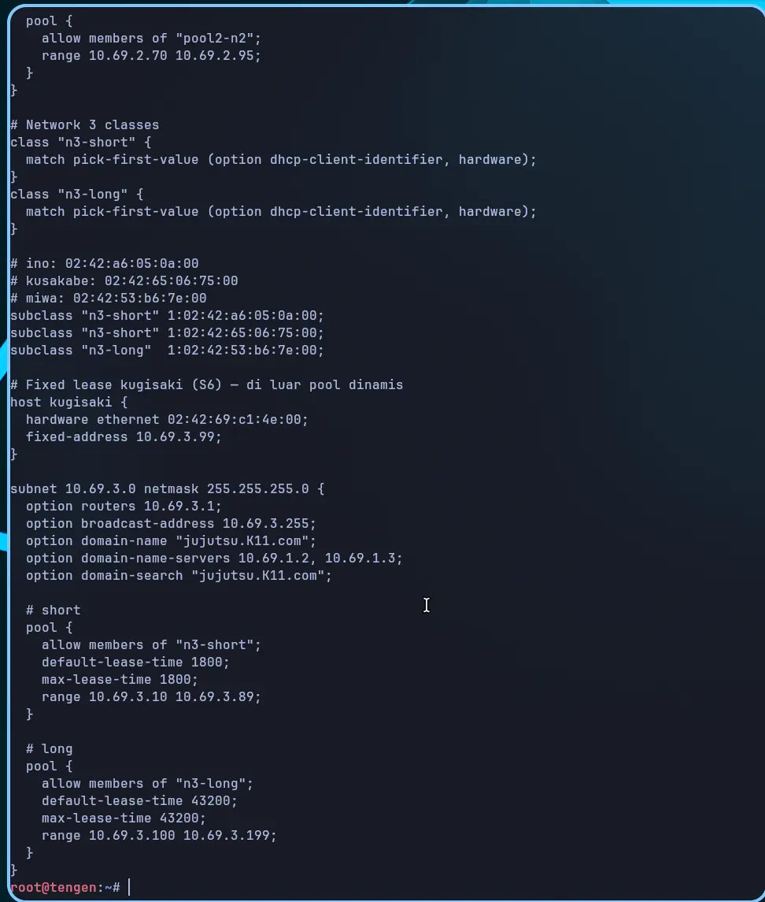
> **[Screenshot: konfigurasi N3 (short/long + domain-search) pada `tengen`]**

Verifikasi lease time berdasarkan IP atau MAC (karena `udhcpc` klien Alpine tidak mengirim hostname ke `dhcpd.leases` secara default), **dijalankan di `tengen`**:

```sh
# Cek selisih timestamp 'starts' dan 'ends'
# 1800 detik = 30 menit (ino/kusakabe), 43200 detik = 12 jam (miwa)
cat /var/lib/dhcp/dhcpd.leases | grep -B 1 -A 8 '02:42:'
```

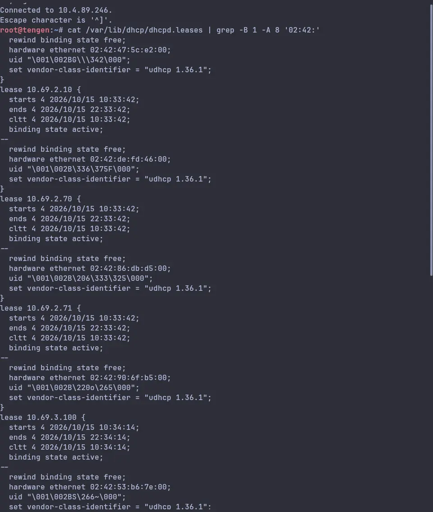
> **[Screenshot: `dhcpd.leases` menunjukkan selisih `starts` ke `ends` 1800s / 43200s]**

---

## Soal 6: Static Lease Kugisaki `.3.99`

**Tujuan.** `kugisaki` static lease berdasarkan MAC → `10.69.3.99` (di luar seluruh pool).

Bagian `host kugisaki { hardware ethernet ...; fixed-address 10.69.3.99; }` sudah disertakan di script Soal 5.

Verifikasi konfigurasi, **dijalankan di `tengen`**:

```sh
cat /etc/dhcp/dhcpd.conf | grep -A 10 'host kugisaki'
service isc-dhcp-server restart; dhcpd -t
```

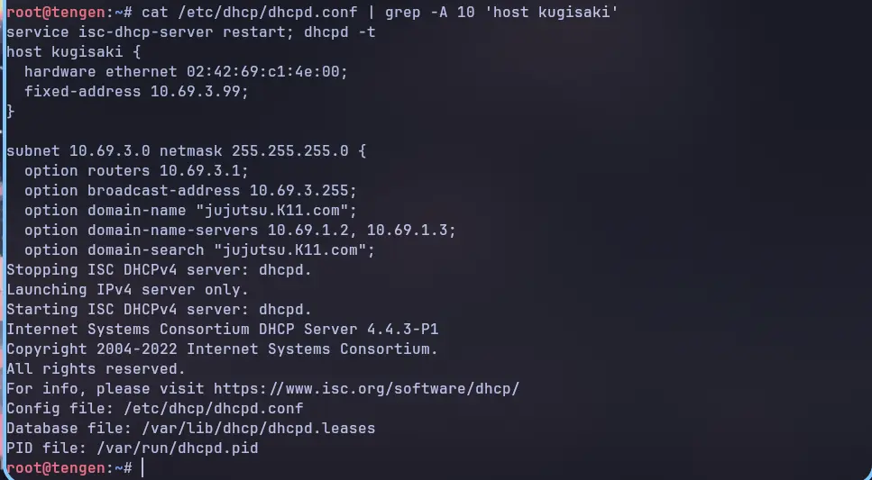
> **[Screenshot: konfigurasi static lease `kugisaki` + validasi]**

Cek alamat di klien `kugisaki`, **dijalankan di `kugisaki`**:

```sh
ip -br addr
```


> **[Screenshot: `ip -br addr` `kugisaki` menunjukkan `10.69.3.99/24`]**

**Catatan penting (sering bikin bingung).** isc-dhcp **tidak** menuliskan alamat dari deklarasi `host`/`fixed-address` ke `/var/lib/dhcp/dhcpd.leases`. File itu hanya mencatat lease yang dialokasikan **dinamis** (Pool 1/Pool 2/short/long). Karena itu `grep` kugisaki di `dhcpd.leases` memang **kosong**, ini perilaku benar, bukan kegagalan. Kugisaki tetap menerima `.3.99`.

Bukti penggantinya:

**1) Di klien `kugisaki`**, alamat sesuai reservasi:
```sh
ip -br addr show eth0        # -> 10.69.3.99/24
```


> **[Screenshot: `ip -br addr` `kugisaki` = `10.69.3.99/24`]**

**2) Di `tengen`**, server meng-ACK `.3.99` (memakai capture Soal 8). Jalankan capture di `tengen`, picu renew di `kugisaki`, lalu lihat `Your-IP`/`DHCPACK` untuk MAC kugisaki:
```sh
# di tengen
sh /root/08-capture-dora.sh 30
# selama capture berjalan, di kugisaki:
udhcpc -i eth0 -n -q
# setelah capture di tengen:
grep -A1 '02:42:69:c1:4e:00' /tmp/dora.txt | grep -E 'Your-IP|DHCP-Message'
```


> **[Screenshot: `DHCPACK`/`Your-IP 10.69.3.99` untuk MAC `02:42:69:c1:4e:00`]**

---

## Soal 7: Verifikasi Konfigurasi Per-Client

**Tujuan.** Pastikan setiap client N2–N3 menerima: mask `/24`, gateway & broadcast benar, DNS `10.69.1.2,10.69.1.3`, domain-search sesuai. Cocokkan lease dengan `/var/lib/dhcp/dhcpd.leases` di `tengen`. Tidak ada tabrakan atau IP di luar kebijakan pool.

Sisi klien, **dijalankan di tiap klien N2/N3** (`itadori`, `fushiguro`, `zenin`, `okkotsu`, `ino`, `kusakabe`, `miwa`, `kugisaki`): `script/common/07-verify-client.sh` (terpasang sebagai `/root/07-verify-client.sh`). Script menampilkan IP/mask/gateway/broadcast/DNS/domain-search, lalu menandai `[OK]`/`[!!]` apakah alamat klien berada di dalam kebijakan pool-nya. Parsing memakai `ip -4 addr show dev eth0` (tanpa flag `-o`/`-br`, karena BusyBox `ip` pada image client tidak mendukungnya).

```sh
sh /root/07-verify-client.sh
```


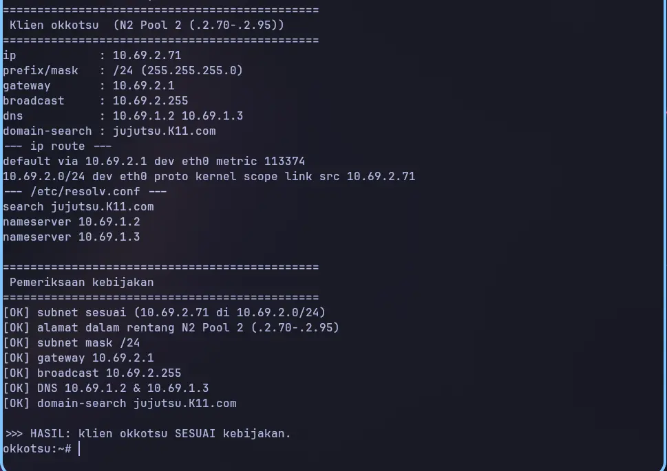
> **[Screenshot: IP/mask/gateway/broadcast/DNS/domain-search + hasil [OK] per klien Divisi A & B]**

Sisi server, **dijalankan di `tengen`**: `script/tengen/07-verify-leases.sh` (`/root/07-verify-leases.sh`) merekap `/var/lib/dhcp/dhcpd.leases` dan mencocokkan tiap MAC klien dengan rentang pool/lease-nya.

```sh
sh /root/07-verify-leases.sh
```


> **[Screenshot: rekap lease aktif di `tengen` + hasil pencocokan kebijakan]**

Catatan: `kugisaki` memperoleh `10.69.3.99` dari deklarasi `host` (fixed-address), namun isc-dhcp 4.4.3 tidak menuliskan lease untuk host statis ke `dhcpd.leases`, pembuktian kugisaki memakai IP di sisi klien + blok `host kugisaki` di `dhcpd.conf` (Soal 6).

---

## Soal 8: Packet Capture DORA + giaddr

**Tujuan.** Buktikan urutan **DHCPDISCOVER → DHCPOFFER → DHCPREQUEST → DHCPACK** saat client minta lease baru. Tunjukkan `giaddr` sesuai interface `jichi` dari subnet client.

Capture di `tengen` memakai script `script/tengen/08-capture-dora.sh` (`/root/08-capture-dora.sh`), **dijalankan di `tengen`**. Jalankan, lalu picu renew pada klien N2/N3 (**dijalankan di klien**, mis. `fushiguro`: `udhcpc -i eth0 -n -q`) selama jendela capture. Opsi `-U` wajib agar tcpdump langsung menulis ke file; tanpanya file kosong saat dibaca.

```sh
# di tengen
./08-capture-dora.sh 40
# selama script berjalan, di klien N2/N3 selain kugisaki:
udhcpc -i eth0 -n -q
```

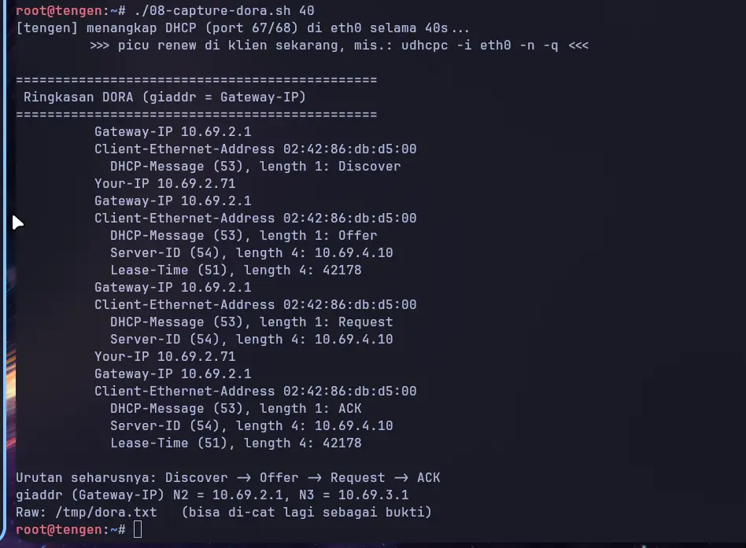
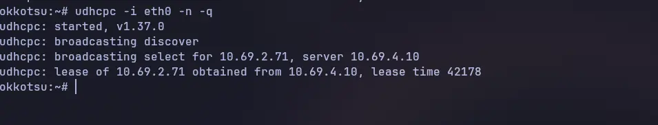
> **[Screenshot: urutan Discover → Offer → Request → ACK + field `giaddr` = `10.69.2.1`/`10.69.3.1`]**

Identifikasi: server IP (`10.69.4.10`), IP yang diberikan (sesuai pool/reservasi), lease time, `giaddr`.

---

## Soal 9: Gangguan Relay

**Tujuan.** Hentikan DHCP Relay di `jichi` → client gagal lease. Hidupkan kembali → lease benar.

Di `jichi` gunakan `script/jichi/09-relay-fault.sh` (`/root/09-relay-fault.sh`), **dijalankan di `jichi`**.

```sh
# di jichi, hentikan relay
service isc-dhcp-relay stop
# di klien N2/N3 (mis. okkotsu), paksa renew:
udhcpc -i eth0 -n -q      # -> 'no lease, failing'
```

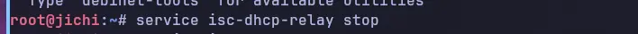
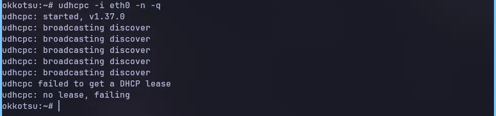
> **[Screenshot: klien gagal memperoleh lease saat relay dihentikan]**

```sh
# di jichi, hidupkan kembali relay
service isc-dhcp-relay start
# di klien, ulangi renew -> lease kembali diperoleh
udhcpc -i eth0 -n -q
```

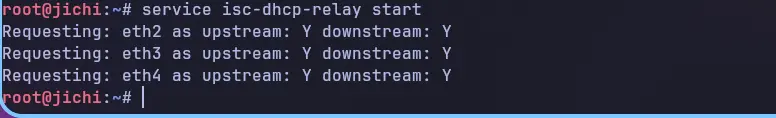
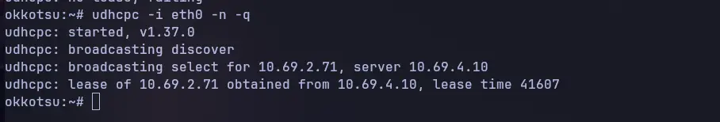
> **[Screenshot: klien memperoleh lease kembali setelah relay dihidupkan]**

---

## Soal 10: Autostart + Restart Node

**Tujuan.** Autostart DHCP Server (`tengen`) dan DHCP Relay (`jichi`); restart kedua node; verifikasi semua kebijakan tetap berlaku.

Pada `tengen` dan `jichi` jalankan `script/common/10-autostart.sh` (`/root/10-autostart.sh`). Script membuktikan baris hook `up bash /root/<node>.sh` di `/etc/network/interfaces`, isi script hook, symlink rc, dan status service. Node `debinet` tidak memakai systemd, jadi autostart dijalankan lewat hook tersebut. Baris hook `jichi` ditulis `jichi/01-setup-routing.sh`, dan baris hook `tengen` ditulis `common/01-static-ip.sh`; script hook `/root/<node>.sh` sendiri di-deploy oleh `push_configs.py`.

```sh
sh /root/10-autostart.sh
```


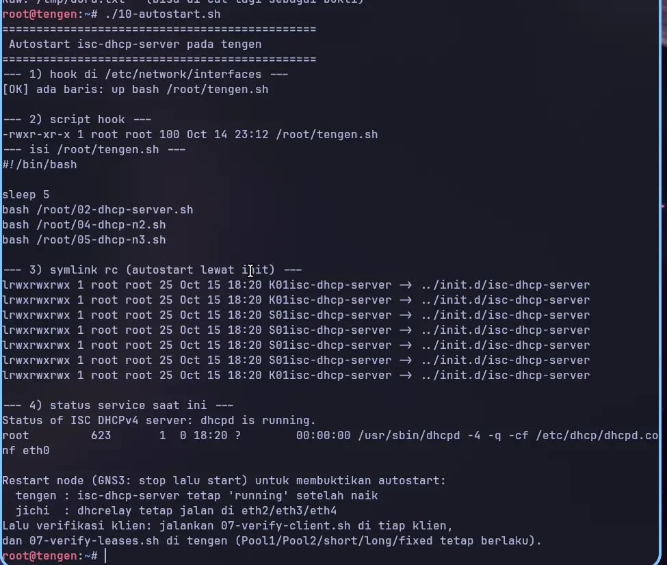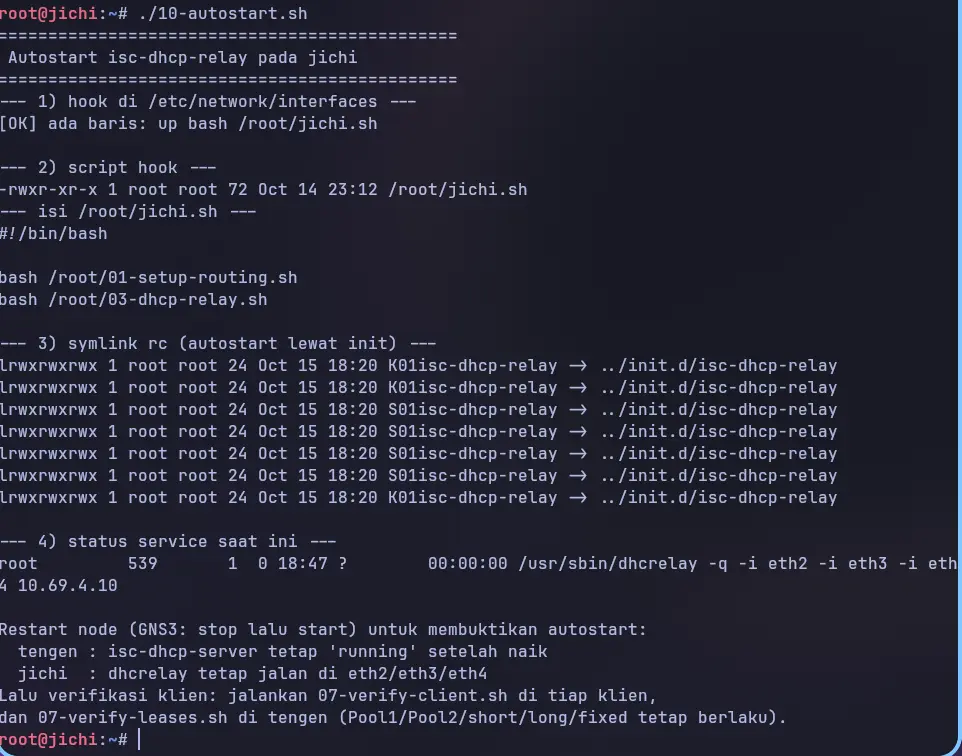
> **[Screenshot: hook autostart + status service pada `tengen` dan `jichi`]**

Restart kedua node (GNS3: stop lalu start). Setelah naik, verifikasi layanan:
```sh
# di tengen
pgrep -a dhcpd      # -> dhcpd running
# di jichi
ps -ef | grep dhcrelay              # -> dhcrelay di eth2/eth3/eth4
```
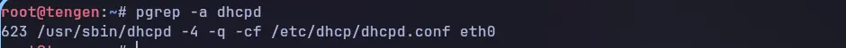

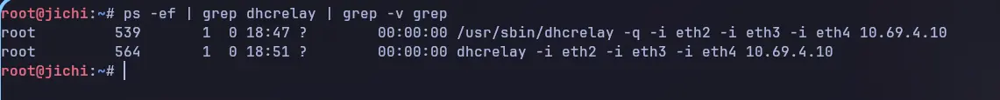
> **[Screenshot: `dhcpd` & `dhcrelay` aktif lagi setelah restart]**

Verifikasi akhir semua klien (Pool 1/Pool 2, short/long, fixed `.3.99`), **dijalankan di tiap klien** dengan `07-verify-client.sh`, dan lease, **dijalankan di `tengen`** dengan `07-verify-leases.sh`:

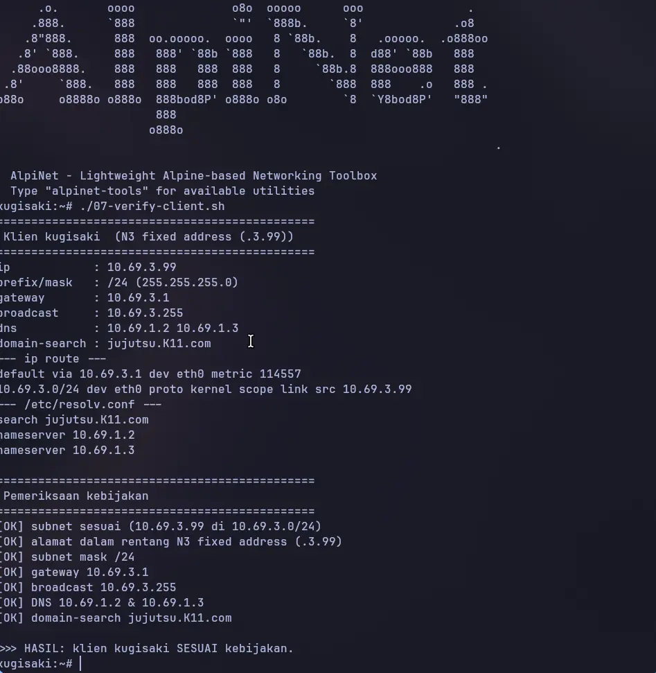
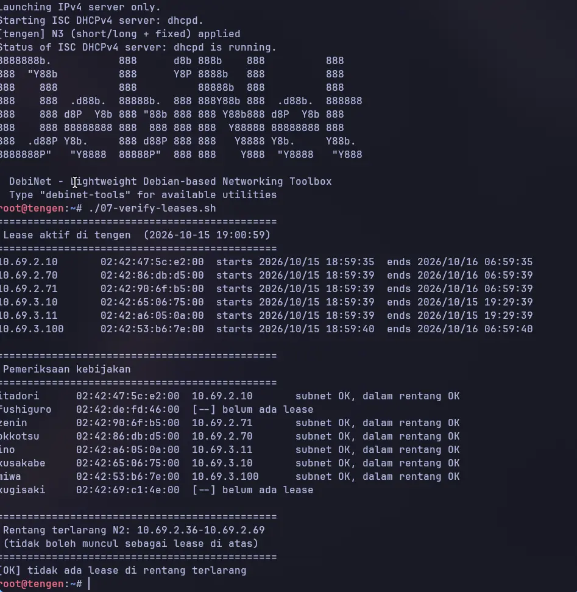
> **[Screenshot: verifikasi akhir Soal 10]**

> **Catatan (persistensi antar-restart).** Setiap node menjalankan `/root/<node>.sh` saat boot melalui baris `up bash /root/<node>.sh` di `/etc/network/interfaces`, `tengen.sh` menjalankan `02`+`04`+`05`, `jichi.sh` menjalankan `01`+`03`. File `/root` tersimpan pada volume node sehingga konfigurasi DHCP otomatis diterapkan ulang setiap restart. Helper `push_configs.py` (root repo) men-deploy ulang script `/root` dan config `/etc` via console node bila perlu.

## Soal 11: DNS Master `utahime` & DNS Slave `shoko`

**Tujuan.** Membangun sistem penamaan domain `jujutsu.K11.com` agar setiap pos tidak perlu menghafal IP mentah. `utahime` (`10.69.1.2`) menjadi **DNS Master** dan `shoko` (`10.69.1.3`) menjadi **DNS Slave** dengan BIND9. Zona berisi **SOA record**, **NS delegasi** untuk kedua server (`ns1` = utahime, `ns2` = shoko), dan **allow-transfer** dari master hanya ke slave. Saat nomor **serial** di master dinaikkan, file zona harus tersinkronisasi otomatis ke slave.

**Skema.** Kedua node berada di Network 1 (DMZ) dan dijalankan sebagai container `debinet` (tanpa systemd), sehingga `named` dijalankan langsung (`nohup named -f`) alih-alih lewat `service`.

| Host | IP | Peran | NS |
|------|----|-------|----|
| `utahime` | `10.69.1.2` | DNS Master | `ns1.jujutsu.K11.com` |
| `shoko`   | `10.69.1.3` | DNS Slave  | `ns2.jujutsu.K11.com` |

### 11.1 Konfigurasi DNS Master (`utahime`)

Script `/root/11-dns-master.sh` memasang `bind9`, menulis `named.conf.options`, `named.conf.local`, dan file zona, lalu menjalankan `named`. Bagian penting:

```sh
zone "jujutsu.K11.com" {
	type master;
	file "/etc/bind/zones/db.jujutsu.K11.com";
	allow-transfer { 10.69.1.3; };   # hanya slave shoko
	notify yes;
	also-notify { 10.69.1.3; };
};
```

File zona memuat SOA, delegasi NS, dan glue A record kedua NS:

```sh
@       IN      SOA     ns1.jujutsu.K11.com. admin.jujutsu.K11.com. (
			1         ; Serial
			604800    ; Refresh
			86400     ; Retry
			2419200   ; Expire
			604800 )  ; Negative Cache TTL
;
@       IN      NS      ns1.jujutsu.K11.com.
@       IN      NS      ns2.jujutsu.K11.com.
ns1     IN      A       10.69.1.2
ns2     IN      A       10.69.1.3
```


> **[Screenshot: script `11-dns-master.sh` di `/root` + `named` berjalan pada `utahime`]**

### 11.2 Konfigurasi DNS Slave (`shoko`)

Script `/root/11-dns-slave.sh` mendeklarasikan zona bertipe **slave** yang mengambil salinan dari master (file zona tidak dibuat manual):

```sh
zone "jujutsu.K11.com" {
	type slave;
	file "/var/cache/bind/db.jujutsu.K11.com";
	masters { 10.69.1.2; };
	allow-notify { 10.69.1.2; };
};
```


> **[Screenshot: script `11-dns-slave.sh` di `/root` + file zona hasil transfer di `shoko`]**

### 11.3 Verifikasi Query `dig` dari Client (`itadori`)

Dari `itadori` (klien Network 2, DHCP `10.69.2.10/24`) dilakukan query ke **kedua** server. SOA dan NS dilayani oleh master maupun slave:

```sh
dig @10.69.1.2 jujutsu.K11.com SOA +short   # dari master
dig @10.69.1.3 jujutsu.K11.com SOA +short   # dari slave
dig @10.69.1.2 jujutsu.K11.com NS +short
```


> **[Screenshot: `dig` SOA & NS ke master dan slave dari `itadori`]**

### 11.4 Bukti Sinkronisasi Otomatis (Naikkan Serial)

Serial dinaikkan di master (`./11-dns-master.sh bump`, serial `1` → `2`). Notify dikirim ke slave, dan zona tersinkronisasi otomatis, query ke **slave** pun menampilkan serial baru:

```sh
# di utahime
./11-dns-master.sh bump
# di itadori
dig @10.69.1.3 jujutsu.K11.com SOA +short
# -> ns1.jujutsu.K11.com. admin.jujutsu.K11.com. 2 604800 86400 2419200 604800
```


> **[Screenshot: serial slave ikut naik menjadi 2 setelah bump di master]**

Sebagai bukti tambahan bahwa `allow-transfer` hanya berlaku untuk slave, transfer zona dari client **ditolak**:

```sh
dig @10.69.1.2 jujutsu.K11.com AXFR   # Transfer failed.
```

---

## Soal 12: A Record, CNAME, Reverse DNS (PTR), dan DNS Forwarder

**Tujuan.** Peta domain harus memetakan pintu masuk utama sekaligus tetap bisa mencari alamat di luar kawasan. Pada `utahime` ditambahkan **A record** `jujutsu.K11.com` yang mengarah ke `gojo`, **CNAME** `www` yang merujuk ke domain utama, **zona PTR** untuk melacak IP `gojo` kembali ke domain resminya, dan **DNS Forwarder** ke gateway internet `192.168.122.1`. Zona PTR ikut disinkronkan ke slave `shoko`.

**Ringkasan record yang ditambahkan:**

| Nama | Tipe | Nilai |
|------|------|-------|
| `jujutsu.K11.com` | A | `10.69.1.4` (gojo) |
| `www.jujutsu.K11.com` | CNAME | `jujutsu.K11.com.` |
| `4.1.69.10.in-addr.arpa` | PTR | `jujutsu.K11.com.` |

### 12.1 Konfigurasi Master (`utahime`)

Script `/root/12-domain-ptr-forwarder.sh` menulis ulang zona forward dan menambah zona reverse, lalu mengaktifkan forwarder:

```sh
options {
	forwarders { 192.168.122.1; };   # gateway internet
	recursion yes;
	dnssec-validation no;
};
```

Isi zona forward (tambahan Soal 12):

```sh
@       IN      A       10.69.1.4          ; pintu masuk utama -> gojo
www     IN      CNAME   jujutsu.K11.com.  ; alias www -> domain utama
```

Zona reverse `1.69.10.in-addr.arpa`:

```sh
@       IN      SOA     ns1.jujutsu.K11.com. admin.jujutsu.K11.com. ( ... )
@       IN      NS      ns1.jujutsu.K11.com.
@       IN      NS      ns2.jujutsu.K11.com.
4       IN      PTR     jujutsu.K11.com.  ; 10.69.1.4 -> jujutsu.K11.com
```


> **[Screenshot: zona forward + PTR + forwarder pada `utahime`]**

### 12.2 Zona PTR pada Slave (`shoko`)

`shoko` mendeklarasikan **dua** zona slave (forward + reverse) sehingga keduanya ikut tersinkron otomatis dari master:

```sh
zone "1.69.10.in-addr.arpa" {
	type slave;
	file "/var/cache/bind/db.1.69.10";
	masters { 10.69.1.2; };
	allow-notify { 10.69.1.2; };
};
```


> **[Screenshot: file zona hasil transfer (`db.jujutsu.K11.com` dan `db.1.69.10`) di `shoko`]**

### 12.3 Verifikasi dari Client (`itadori`)

Dari `itadori` diuji A record, CNAME, PTR, dan forwarder di **kedua** server:

```sh
dig @10.69.1.2 jujutsu.K11.com A +short          # -> 10.69.1.4
dig @10.69.1.2 www.jujutsu.K11.com CNAME +short  # -> jujutsu.K11.com.
dig @10.69.1.2 -x 10.69.1.4 +short               # -> jujutsu.K11.com.
dig @10.69.1.2 google.com A +short               # -> (via forwarder)
```

Hasil: A record mengarah ke `10.69.1.4` baik di master maupun slave, `www` menunjuk `jujutsu.K11.com.` lalu resolve ke `10.69.1.4`, dan PTR `10.69.1.4` mengembalikan `jujutsu.K11.com.`.

Client juga tetap dapat menjangkau alamat di luar kawasan: resolusi `google.com` diteruskan forwarder ke `192.168.122.1`, dan ping berhasil.

```sh
ping -c 3 google.com
# 3 packets transmitted, 3 received, 0% packet loss
```


> **[Screenshot: `dig` A/CNAME/PTR dan `ping google.com` dari `itadori`]**

---
