# Jarkom-Modul-3-2026-K-11

Laporan Praktikum Modul 3 — Komunikasi Data & Jaringan Komputer 2026 **Curtain Protocol: Shibuya
Incident — Pemulihan Jaringan dan Layanan Jujutsu High**

Anggota Kelompok K-11:

- Hasheemi Rafsanjani (5027251015)
- Husam Danish (5027251060)

Konvensi: prefix jaringan internal `10.69.x.x`, netmask `/24`, domain `jujutsu.K11.com`.

## Soal 1 — Konektivitas Dasar dan Routing `jichi`

**Tujuan.** Memulihkan konektivitas antar-zona. `jichi` berperan sebagai router utama: antarmuka
`eth0` memperoleh WAN dari NAT, sedangkan `eth1`–`eth4` menjadi gateway **Network 1–4**. IPv4
forwarding dan source NAT (masquerade) diaktifkan, lalu setiap host infrastruktur diberi IP statis
sesuai rancangan.

**Pemetaan interface `jichi`:**

| Interface | Peran                              | Alamat               |
| --------- | ---------------------------------- | -------------------- |
| `eth0`    | WAN (DHCP dari NAT1)               | `192.168.122.207/24` |
| `eth1`    | Gateway Network 1 (DMZ)            | `10.69.1.1/24`       |
| `eth2`    | Gateway Network 2 (Klien Divisi A) | `10.69.2.1/24`       |
| `eth3`    | Gateway Network 3 (Klien Divisi B) | `10.69.3.1/24`       |
| `eth4`    | Gateway Network 4 (Data Center)    | `10.69.4.1/24`       |

### 1.1 Konfigurasi Interface `jichi`

Konfigurasi `/etc/network/interfaces` pada `jichi`:

```sh
cat /etc/network/interfaces
```

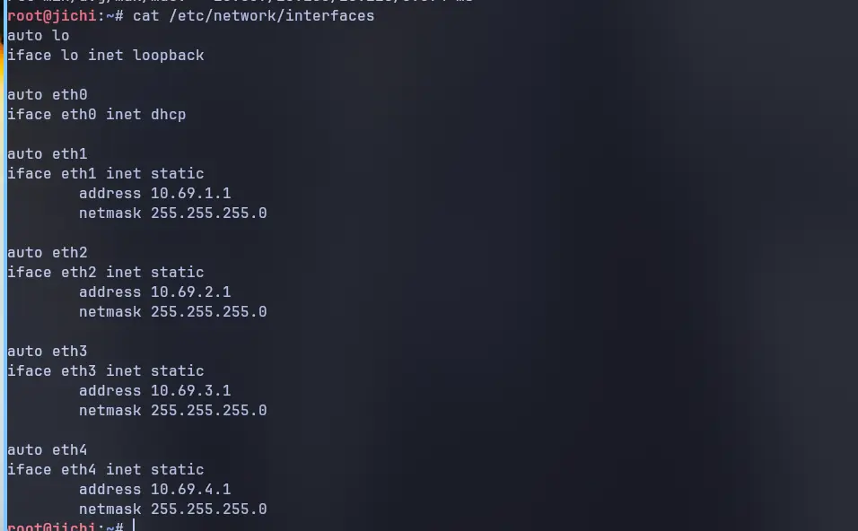

> **[Screenshot: `/etc/network/interfaces` pada `jichi`]**

### 1.2 Aktifkan IPv4 Forwarding dan Source NAT

Diaktifkan melalui script `/root/01-setup-routing.sh`:

```sh
....
iptables -t nat -F POSTROUTING 2>/dev/null || true
iptables -F FORWARD 2>/dev/null || true

iptables -t nat -A POSTROUTING -o eth0 -j MASQUERADE
for i in 1 2 3 4; do
	iptables -A FORWARD -i eth$i -o eth0 -j ACCEPT
done
for i in 1 2 3 4; do
	iptables -A FORWARD -i eth0 -o eth$i -m state --state ESTABLISHED,RELATED -j ACCEPT
done
....
```

yang kemudian akan menghasilkan seperti ini:

```sh
sysctl -w net.ipv4.ip_forward=1
iptables -t nat -A POSTROUTING -o eth0 -j MASQUERADE
iptables -A FORWARD -i eth1 -o eth0 -j ACCEPT
iptables -A FORWARD -i eth2 -o eth0 -j ACCEPT
iptables -A FORWARD -i eth3 -o eth0 -j ACCEPT
iptables -A FORWARD -i eth4 -o eth0 -j ACCEPT
iptables -A FORWARD -i eth0 -o eth1 -m state --state ESTABLISHED,RELATED -j ACCEPT
```

Hasil `ip addr show` pada `jichi` (semua interface naik dengan alamat benar):
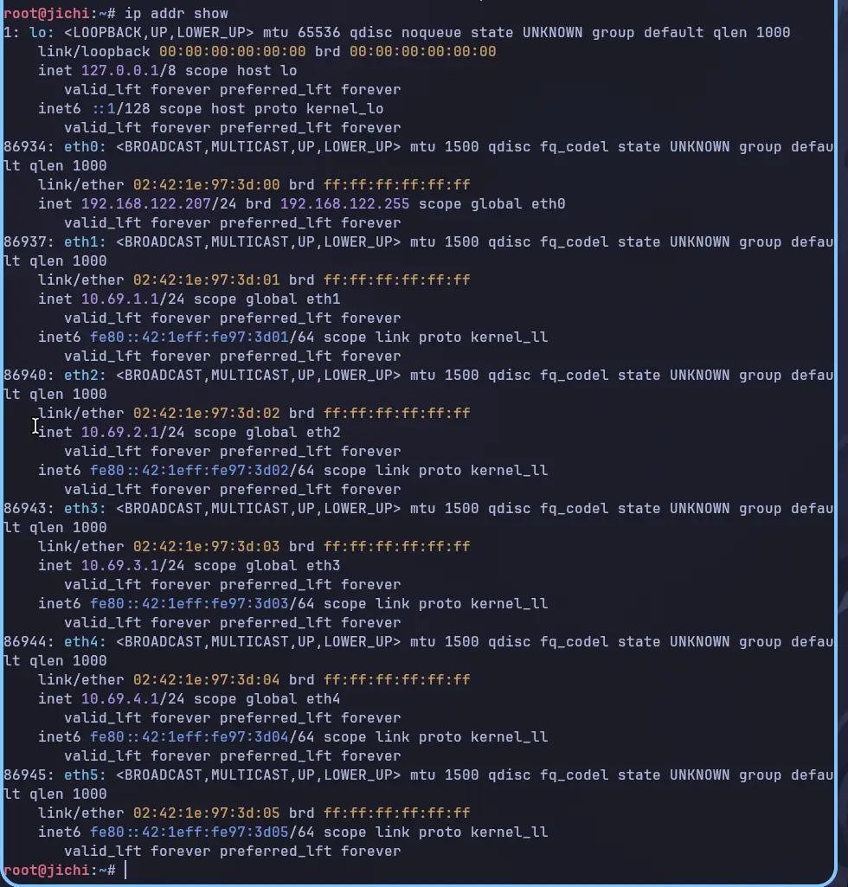

IPv4 forwarding aktif:

```sh
cat /proc/sys/net/ipv4/ip_forward
```

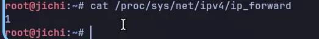

Aturan masquerade pada tabel NAT:

```sh
iptables -t nat -L POSTROUTING -v -n
```

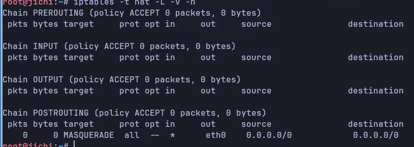

### 1.3 Verifikasi Gateway (`jichi` → NAT)

`jichi` dapat menjangkau gateway NAT `192.168.122.1`:

```sh
ping -c3 192.168.122.1
```

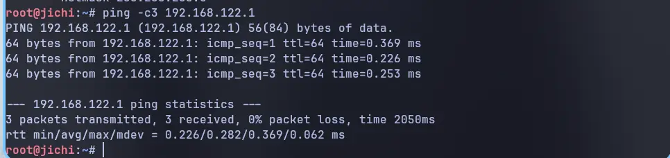

### 1.4 Verifikasi IPv4 Forwarding

Forwarding diuji dari host infrastruktur menuju gateway network-nya. Contoh pada `tengen` (Network
4):

```sh
ping -c3 10.69.4.1
```

Dan dari host klien/infrastruktur melalui masquerade `jichi` — contoh `tengen` (Network 4):

```sh
ping -c3 1.1.1.1
```

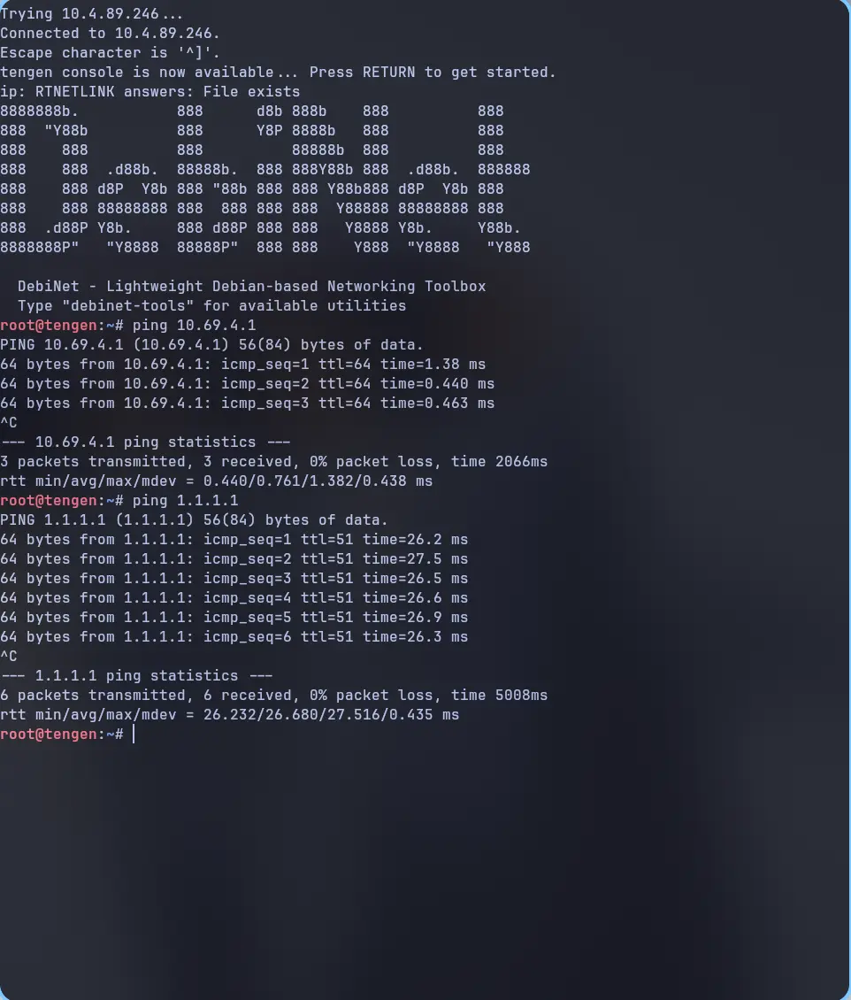

Pada `Utahime` 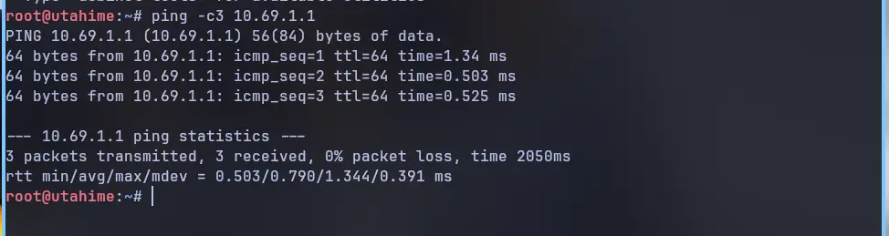

> **[Screenshot: `ping -c3 10.69.1.1` dari `utahime` (Network 1)]**

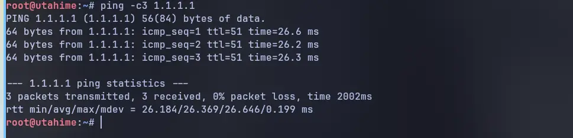

> **[Screenshot: `ping -c3 1.1.1.1` dari `utahime` (Network 1)]**

### 1.5 Verifikasi Akses Eksternal (Masquerading)

Akses eksternal dibuktikan dari `jichi` sendiri:

```sh
ping -c3 192.168.122.1
ping -c3 8.8.8.8
```

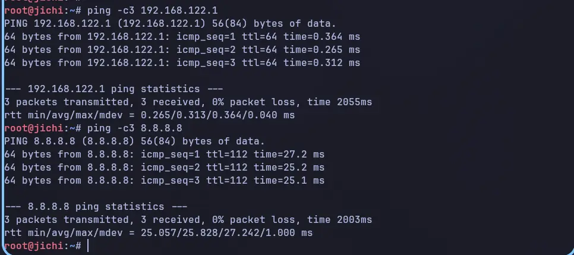

### 1.6 IP Statis Host Infrastruktur

Selain `jichi`, host infrastruktur diberi IP statis. Disimpan sebagai script di `/root` tiap node.
Rancangan:

| Network | Host                           | Alamat          | Gateway     |
| ------- | ------------------------------ | --------------- | ----------- |
| 1       | `utahime` (DNS master)         | `10.69.1.2/24`  | `10.69.1.1` |
| 1       | `shoko` (DNS slave)            | `10.69.1.3/24`  | `10.69.1.1` |
| 1       | `gojo` (reverse proxy)         | `10.69.1.4/24`  | `10.69.1.1` |
| 4       | `geto` (internal LB)           | `10.69.4.2/24`  | `10.69.4.1` |
| 4       | `maki` (worker web)            | `10.69.4.3/24`  | `10.69.4.1` |
| 4       | `panda` (worker web)           | `10.69.4.4/24`  | `10.69.4.1` |
| 4       | `nanami` (worker API)          | `10.69.4.5/24`  | `10.69.4.1` |
| 4       | `todo` (worker API)            | `10.69.4.6/24`  | `10.69.4.1` |
| 4       | `kirara` (worker API cadangan) | `10.69.4.7/24`  | `10.69.4.1` |
| 4       | `yaga` (DB master)             | `10.69.4.8/24`  | `10.69.4.1` |
| 4       | `inumaki` (DB slave)           | `10.69.4.9/24`  | `10.69.4.1` |
| 4       | `tengen` (DHCP server)         | `10.69.4.10/24` | `10.69.4.1` |

Contoh bukti IP statis pada host Network 1 (`utahime`) dan host Network 4 (`tengen`):

```sh
ip -br addr
```

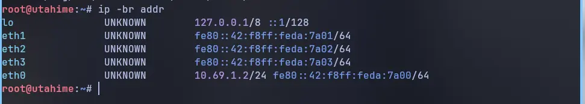

> **[Screenshot: `ip -br addr` pada `utahime` (Network 1)]**

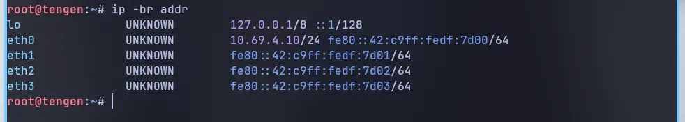

> **[Screenshot: `ip -br addr` pada `tengen` (Network 4)]**

---

## Soal 2 — DHCP Server `tengen`

**Tujuan.** `tengen` (Data Center, `10.69.4.10`) menjadi DHCP server. Network 4 dideklarasikan
sebagai **subnet lokal tanpa pool dinamis**, sedangkan scope untuk **Network 2** dan **Network 3**
disiapkan agar permintaan dari kedua subnet dapat dilayani. Service harus aktif tanpa error **“No
subnet declaration”**.

**Langkah.** Install `isc-dhcp-server`, set `INTERFACESv4="eth0"`, tulis `/etc/dhcp/dhcpd.conf`
berisi tiga deklarasi `subnet` (N4 lokal, N2 dan N3 untuk relay), lalu validasi dan restart service.
Disimpan sebagai script `/root/02-dhcp-server.sh`:

```sh
cat /root/02-dhcp-server.sh
```

Isi `/etc/dhcp/dhcpd.conf`:

```sh
cat /etc/dhcp/dhcpd.conf
```

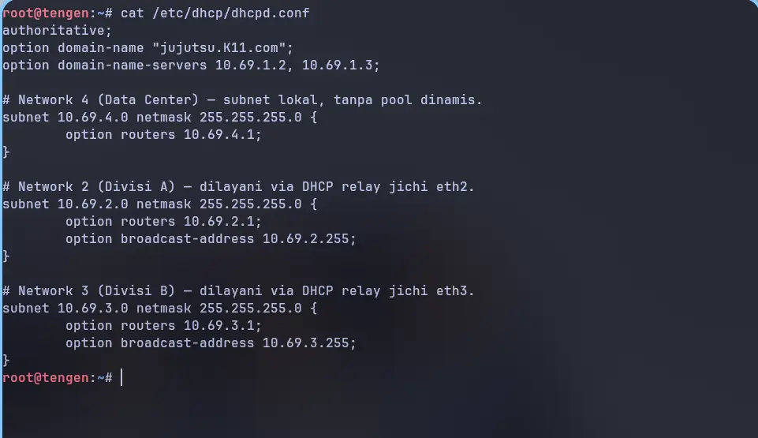

> **[Screenshot: `/etc/dhcp/dhcpd.conf` pada `tengen`]**

Validasi konfigurasi:

```sh
dhcpd -t -cf /etc/dhcp/dhcpd.conf
```

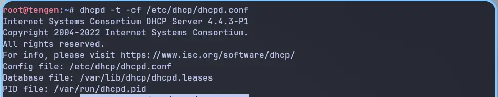

> **[Screenshot: output `dhcpd -t` tanpa error]**

Status service aktif:

```sh
service isc-dhcp-server status
```

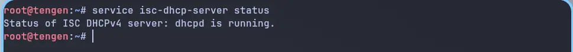

> **[Screenshot: `isc-dhcp-server` aktif]**

Pesan startup dhcpd (termasuk bila ada “No subnet declaration”) tak masuk syslog karena image
debinet tanpa syslog daemon — tampil di console saat restart:

```sh
service isc-dhcp-server restart
```

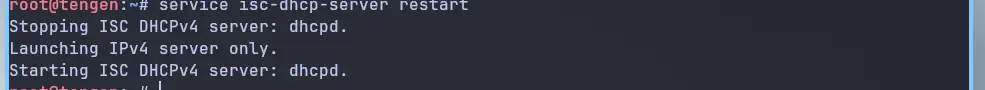

> **[Screenshot: output restart tanpa “No subnet declaration”]**

---

## Soal 11 — DNS Master `utahime` & DNS Slave `shoko`

**Tujuan.** Membangun sistem penamaan domain `jujutsu.K11.com` agar setiap pos tidak perlu menghafal
IP mentah. `utahime` (`10.69.1.2`) menjadi **DNS Master** dan `shoko` (`10.69.1.3`) menjadi **DNS
Slave** dengan BIND9. Zona berisi **SOA record**, **NS delegasi** untuk kedua server (`ns1` =
utahime, `ns2` = shoko), dan **allow-transfer** dari master hanya ke slave. Saat nomor **serial** di
master dinaikkan, file zona harus tersinkronisasi otomatis ke slave.

**Skema.** Kedua node berada di Network 1 (DMZ) dan dijalankan sebagai container `debinet` (tanpa
systemd), sehingga `named` dijalankan langsung (`nohup named -f`) alih-alih lewat `service`.

| Host      | IP          | Peran      | NS                    |
| --------- | ----------- | ---------- | --------------------- |
| `utahime` | `10.69.1.2` | DNS Master | `ns1.jujutsu.K11.com` |
| `shoko`   | `10.69.1.3` | DNS Slave  | `ns2.jujutsu.K11.com` |

### 11.1 Konfigurasi DNS Master (`utahime`)

Script `/root/11-dns-master.sh` memasang `bind9`, menulis `named.conf.options`, `named.conf.local`,
dan file zona, lalu menjalankan `named`. Bagian penting:

```sh
zone "jujutsu.K11.com" {
	type master;
	file "/etc/bind/zones/db.jujutsu.K11.com";
	allow-transfer { 10.69.1.3; };   # hanya slave shoko
	notify yes;
	also-notify { 10.69.1.3; };
};
```

File zona memuat SOA, delegasi NS, dan glue A record kedua NS:

```sh
@       IN      SOA     ns1.jujutsu.K11.com. admin.jujutsu.K11.com. (
			1         ; Serial
			604800    ; Refresh
			86400     ; Retry
			2419200   ; Expire
			604800 )  ; Negative Cache TTL
;
@       IN      NS      ns1.jujutsu.K11.com.
@       IN      NS      ns2.jujutsu.K11.com.
ns1     IN      A       10.69.1.2
ns2     IN      A       10.69.1.3
```

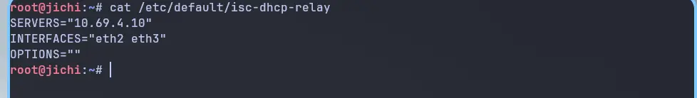

> **[Screenshot: script `11-dns-master.sh` di `/root` + `named` berjalan pada `utahime`]**

### 11.2 Konfigurasi DNS Slave (`shoko`)

Script `/root/11-dns-slave.sh` mendeklarasikan zona bertipe **slave** yang mengambil salinan dari
master (file zona tidak dibuat manual):

```sh
zone "jujutsu.K11.com" {
	type slave;
	file "/var/cache/bind/db.jujutsu.K11.com";
	masters { 10.69.1.2; };
	allow-notify { 10.69.1.2; };
};
```

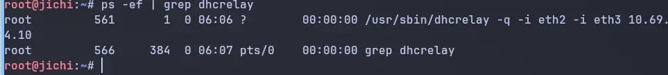

> **[Screenshot: script `11-dns-slave.sh` di `/root` + file zona hasil transfer di `shoko`]**

### 11.3 Verifikasi Query `dig` dari Client (`itadori`)

Dari `itadori` (klien Network 2, DHCP `10.69.2.10/24`) dilakukan query ke **kedua** server. SOA dan
NS dilayani oleh master maupun slave:

```sh
dig @10.69.1.2 jujutsu.K11.com SOA +short   # dari master
dig @10.69.1.3 jujutsu.K11.com SOA +short   # dari slave
dig @10.69.1.2 jujutsu.K11.com NS +short
```

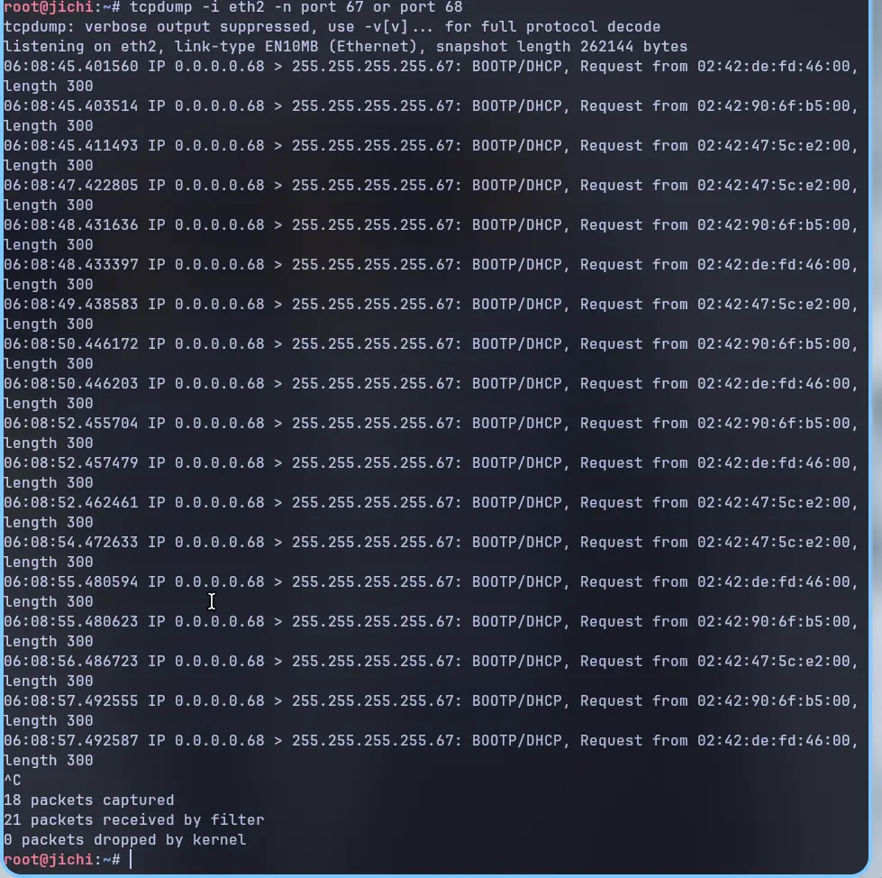

> **[Screenshot: `dig` SOA & NS ke master dan slave dari `itadori`]**

### 11.4 Bukti Sinkronisasi Otomatis (Naikkan Serial)

Serial dinaikkan di master (`./11-dns-master.sh bump`, serial `1` → `2`). Notify dikirim ke slave,
dan zona tersinkronisasi otomatis — query ke **slave** pun menampilkan serial baru:

```sh
# di utahime
./11-dns-master.sh bump
# di itadori
dig @10.69.1.3 jujutsu.K11.com SOA +short
# -> ns1.jujutsu.K11.com. admin.jujutsu.K11.com. 2 604800 86400 2419200 604800
```

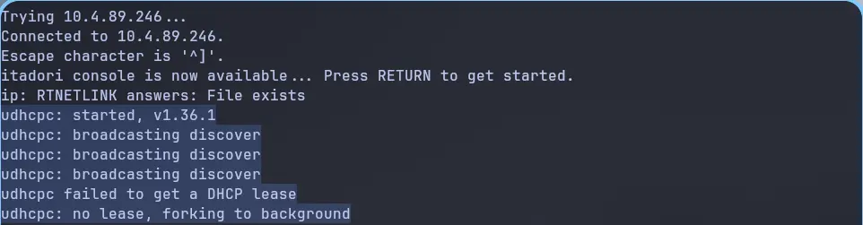

> **[Screenshot: serial slave ikut naik menjadi 2 setelah bump di master]**

Sebagai bukti tambahan bahwa `allow-transfer` hanya berlaku untuk slave, transfer zona dari client
**ditolak**:

```sh
dig @10.69.1.2 jujutsu.K11.com AXFR   # Transfer failed.
```

---

## Soal 12 — A Record, CNAME, Reverse DNS (PTR), dan DNS Forwarder

**Tujuan.** Peta domain harus memetakan pintu masuk utama sekaligus tetap bisa mencari alamat di
luar kawasan. Pada `utahime` ditambahkan **A record** `jujutsu.K11.com` yang mengarah ke `gojo`,
**CNAME** `www` yang merujuk ke domain utama, **zona PTR** untuk melacak IP `gojo` kembali ke domain
resminya, dan **DNS Forwarder** ke gateway internet `192.168.122.1`. Zona PTR ikut disinkronkan ke
slave `shoko`.

**Ringkasan record yang ditambahkan:**

| Nama                     | Tipe  | Nilai              |
| ------------------------ | ----- | ------------------ |
| `jujutsu.K11.com`        | A     | `10.69.1.4` (gojo) |
| `www.jujutsu.K11.com`    | CNAME | `jujutsu.K11.com.` |
| `4.1.69.10.in-addr.arpa` | PTR   | `jujutsu.K11.com.` |

### 12.1 Konfigurasi Master (`utahime`)

Script `/root/12-domain-ptr-forwarder.sh` menulis ulang zona forward dan menambah zona reverse, lalu
mengaktifkan forwarder:

```sh
options {
	forwarders { 192.168.122.1; };   # gateway internet
	recursion yes;
	dnssec-validation no;
};
```

Isi zona forward (tambahan Soal 12):

```sh
@       IN      A       10.69.1.4          ; pintu masuk utama -> gojo
www     IN      CNAME   jujutsu.K11.com.  ; alias www -> domain utama
```

Zona reverse `1.69.10.in-addr.arpa`:

```sh
@       IN      SOA     ns1.jujutsu.K11.com. admin.jujutsu.K11.com. ( ... )
@       IN      NS      ns1.jujutsu.K11.com.
@       IN      NS      ns2.jujutsu.K11.com.
4       IN      PTR     jujutsu.K11.com.  ; 10.69.1.4 -> jujutsu.K11.com
```

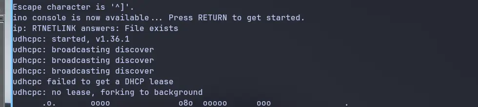

> **[Screenshot: zona forward + PTR + forwarder pada `utahime`]**

### 12.2 Zona PTR pada Slave (`shoko`)

`shoko` mendeklarasikan **dua** zona slave (forward + reverse) sehingga keduanya ikut tersinkron
otomatis dari master:

```sh
zone "1.69.10.in-addr.arpa" {
	type slave;
	file "/var/cache/bind/db.1.69.10";
	masters { 10.69.1.2; };
	allow-notify { 10.69.1.2; };
};
```

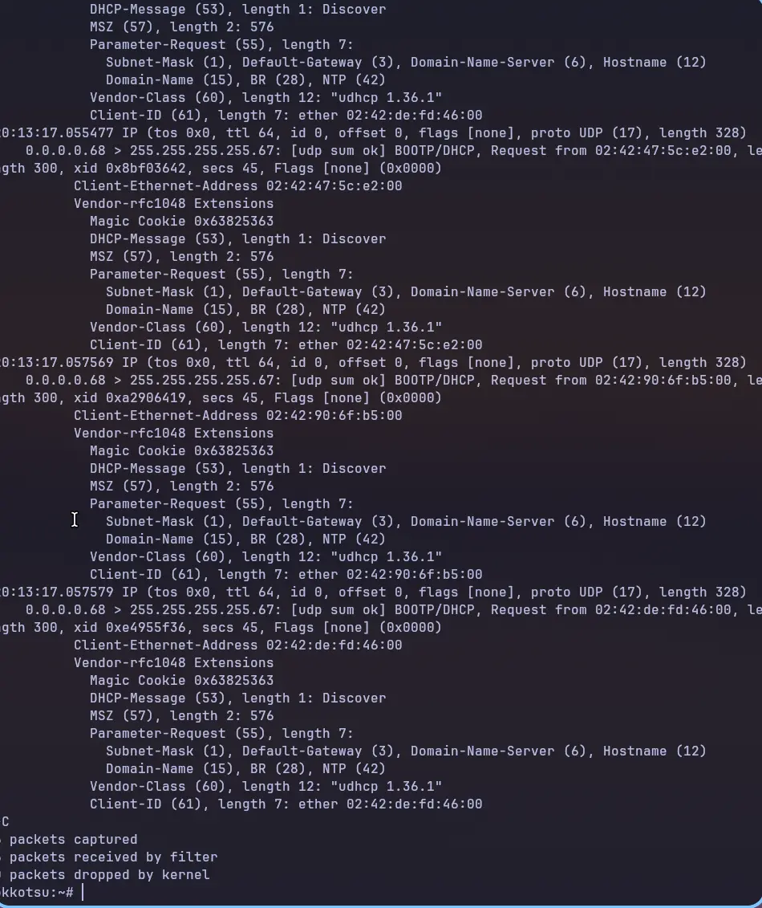

> **[Screenshot: file zona hasil transfer (`db.jujutsu.K11.com` dan `db.1.69.10`) di `shoko`]**

### 12.3 Verifikasi dari Client (`itadori`)

Dari `itadori` diuji A record, CNAME, PTR, dan forwarder di **kedua** server:

```sh
dig @10.69.1.2 jujutsu.K11.com A +short          # -> 10.69.1.4
dig @10.69.1.2 www.jujutsu.K11.com CNAME +short  # -> jujutsu.K11.com.
dig @10.69.1.2 -x 10.69.1.4 +short               # -> jujutsu.K11.com.
dig @10.69.1.2 google.com A +short               # -> (via forwarder)
```

Hasil: A record mengarah ke `10.69.1.4` baik di master maupun slave, `www` menunjuk
`jujutsu.K11.com.` lalu resolve ke `10.69.1.4`, dan PTR `10.69.1.4` mengembalikan
`jujutsu.K11.com.`.

Client juga tetap dapat menjangkau alamat di luar kawasan: resolusi `google.com` diteruskan
forwarder ke `192.168.122.1`, dan ping berhasil.

```sh
ping -c 3 google.com
# 3 packets transmitted, 3 received, 0% packet loss
```

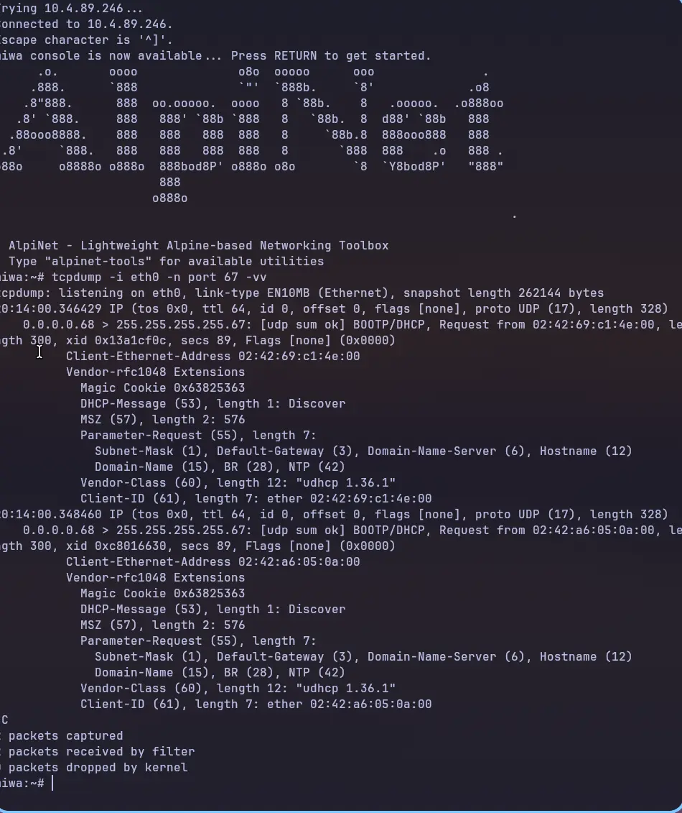

> **[Screenshot: `dig` A/CNAME/PTR dan `ping google.com` dari `itadori`]**

---

## Soal 3 — DHCP Relay `jichi`

**Tujuan.** Permintaan alamat dari Divisi A dan Divisi B tidak dapat menyeberangi subnet secara
langsung. `jichi` dikonfigurasi sebagai **DHCP Relay** menuju `tengen` (`10.69.4.10`), memakai
`eth2` untuk Network 2 dan `eth3` untuk Network 3. Client dari kedua subnet harus berhasil
memperoleh lease melalui relay.

**Langkah.** Install `isc-dhcp-relay`, set `SERVERS="10.69.4.10"` dan `INTERFACES="eth2 eth3 eth4"`
(`eth4` = sisi server `tengen`, tanpa ini balasan DHCP tak kembali), lalu restart service. Disimpan
sebagai script `/root/03-dhcp-relay.sh`:

```sh
cat /root/03-dhcp-relay.sh
```

Isi `/etc/default/isc-dhcp-relay`:

```sh
cat /etc/default/isc-dhcp-relay
```


> **[Screenshot: `/etc/default/isc-dhcp-relay` pada `jichi`]**

Proses `dhcrelay` aktif pada `eth2`, `eth3`, & `eth4`:

```sh
ps -ef | grep dhcrelay
```


> **[Screenshot: proses `dhcrelay` berjalan]**

Bukti relay berjalan (client N2 mengirim DISCOVER):

```sh
tcpdump -i eth2 -n port 67 or port 68
```


> **[Screenshot: `tcpdump` pada `jichi` (eth2) — `DHCPDISCOVER` dari client Network 2]**

Client Network 2 tidak memperoleh lease karena pool DHCP belum dikonfigurasi (akan diisi pada Soal
4–5). Bukti pada client N2 dan N3 saat ini:

N2: 

N3: 

**Bukti relay berhasil meneruskan ke server DHCP (`10.69.4.10`)**

```sh
tcpdump -i eth0 -n port 67 -vv
```


> **[Screenshot: `tcpdump` pada `tengen` (eth0) — `DHCPDISCOVER` dari subnet N2/N3 dengan `giaddr` =
> `10.69.2.1` (N2) dan `10.69.3.1` (N3)]**

Pada sisi `tengen`, terlihat `DHCPDISCOVER` yang diteruskan oleh `dhcrelay` dari `jichi`
(`10.69.4.1`), dengan `Gateway-IP` (giaddr) sesuai subnet client. Tanpa pool DHCP yang diaktifkan,
dhcpd tidak mengirim `DHCPOFFER`. Oleh karena itu, dapat disimpulkan bahwa **relay telah berjalan
sesuai konfigurasi** — hanya `pool` untuk N2 dan N3 yang belum ditambahkan (akan dilakukan pada Soal
4–5).

---

## Soal 4 — DHCP Pool & Class Network 2

**Tujuan.** Membagi pool N2: Pool 1 (`10.69.2.10–10.69.2.35`) untuk `itadori`, `fushiguro`; Pool 2
(`10.69.2.70–10.69.2.95`) untuk `zenin`, `okkotsu`. Rentang `10.69.2.36–10.69.2.69` dilarang.
Pisahkan menggunakan **DHCP class** berdasarkan MAC.

Script: `/root/04-dhcp-n2.sh` (disimpan di `script/tengen/04-dhcp-n2.sh`).

Konfigurasi `/etc/dhcp/dhcpd.conf` (bagian N2):

```sh
cat /etc/dhcp/dhcpd.conf
```

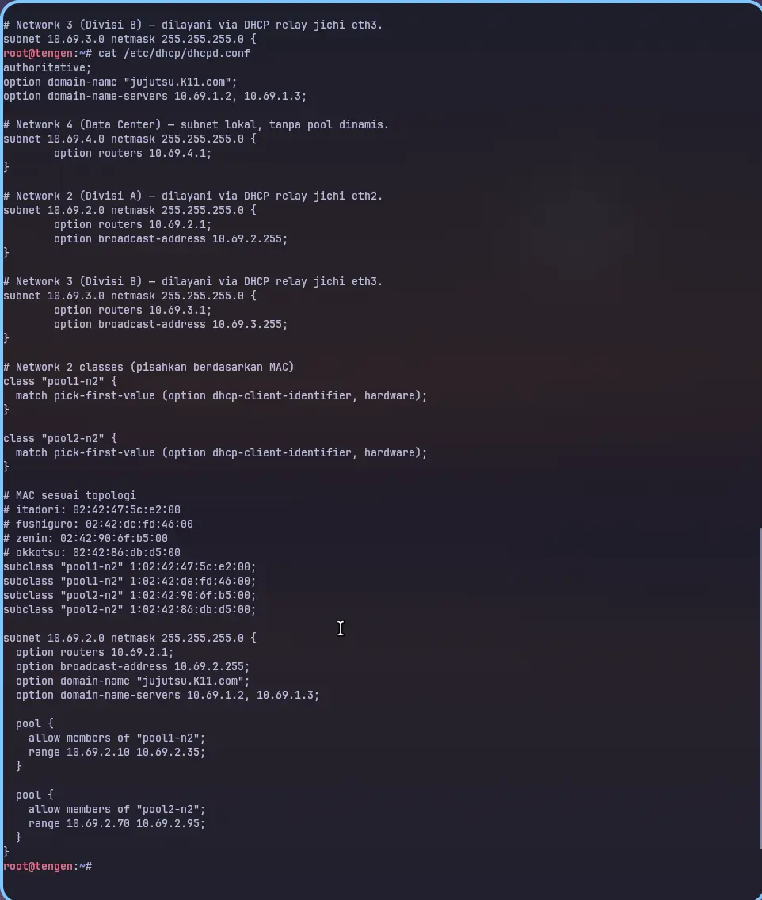

> **[Screenshot: konfigurasi pool & class N2 pada `tengen`]**

Validasi:

```sh
dhcpd -t -cf /etc/dhcp/dhcpd.conf
service isc-dhcp-server restart
service isc-dhcp-server status
```

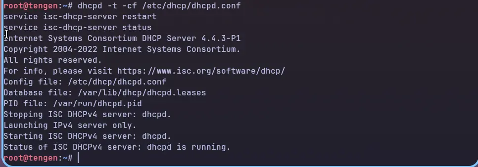

> **[Screenshot: validasi + status `isc-dhcp-server` setelah Soal 4]**

Verifikasi client N2 memperoleh lease sesuai pool:

```sh
# itadori & fushiguro -> 10.69.2.10–.35; zenin & okkotsu -> 10.69.2.70–.95
ip -br addr
```

`itadori` 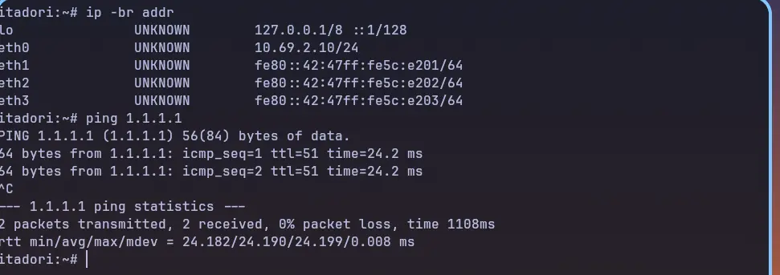

`fushiguro` 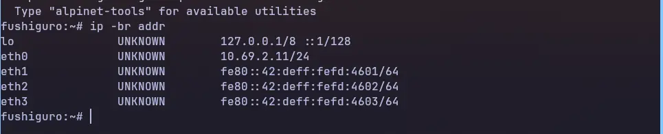

`zenin` 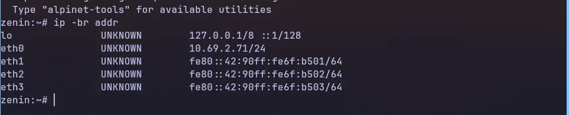

`okkotsu` 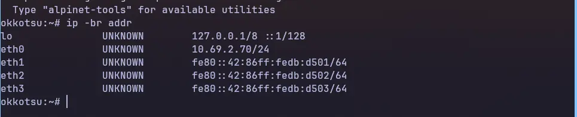

> **[Screenshot: `ip -br addr` client N2]**

> **Catatan (perbaikan).** Nilai `subclass` wajib diawali `1:` (tipe hardware Ethernet). Client
> mengirim DHCP **Client-ID** `ether 02:42:...`, yaitu byte `01:02:42:...`, jadi penulisannya
> `subclass "pool1-n2" 1:02:42:47:5c:e2:00;`. Tanpa prefix `1:`, kelas tak cocok (`pick-first-value`
> mengembalikan Client-ID 7-byte), `dhcpd -d` mencatat `network 10.69.2.0/24: no free leases`, dan
> client tak menerima lease.

---

**Tujuan.** N3: `ino`, `kusakabe` short lease **1800s** (pool `.3.10–.3.89`); `miwa` long lease
**43200s** (pool `.3.100–.3.199`). Atur `default-lease-time`/`max-lease-time` per kelas. Tambah DNS
`10.69.1.2,10.69.1.3` + `domain-search jujutsu.K11.com`.

Script: `/root/05-dhcp-n3.sh` (`script/tengen/05-dhcp-n3.sh`).

Konfigurasi N3 di `/etc/dhcp/dhcpd.conf`:

```sh
cat /etc/dhcp/dhcpd.conf
```


> **[Screenshot: konfigurasi N3 (short/long + domain-search) pada `tengen`]**

Verifikasi lease time (contoh):

```sh
cat /var/lib/dhcp/dhcpd.leases | grep -A 20 -B 5 'ino\|kusakabe\|miwa'
```


> **[Screenshot: `dhcpd.leases` menunjukkan `lease-time` 1800 / 43200]**

---

## Soal 6 — Static Lease Kugisaki `.3.99`

**Tujuan.** `kugisaki` static lease berdasarkan MAC → `10.69.3.99` (di luar seluruh pool).

Bagian `host kugisaki { hardware ethernet ...; fixed-address 10.69.3.99; }` sudah disertakan di
script Soal 5.

Verifikasi:

```sh
cat /etc/dhcp/dhcpd.conf | grep -A 10 'host kugisaki'
service isc-dhcp-server restart; dhcpd -t
```


> **[Screenshot: konfigurasi static lease `kugisaki` + validasi]**

Cek lease di client `kugisaki`:

```sh
ip -br addr
```


> **[Screenshot: `ip -br addr` `kugisaki` menunjukkan `10.69.3.99/24`]**

Cek di `/var/lib/dhcp/dhcpd.leases`:

```sh
cat /var/lib/dhcp/dhcpd.leases | grep -B 5 -A 15 '02:42:69:c1:4e'
```


> **[Screenshot: `dhcpd.leases` menandakan fixed address untuk MAC kugisaki]**

---

## Soal 7 — Verifikasi Konfigurasi Per-Client

**Tujuan.** Pastikan setiap client N2–N3 menerima: mask `/24`, gateway & broadcast benar, DNS
`10.69.1.2,10.69.1.3`, domain-search sesuai. Cocokkan lease dengan `/var/lib/dhcp/dhcpd.leases` di
`tengen`. Tidak ada tabrakan atau IP di luar kebijakan pool.

Verifikasi routing & info (contoh untuk beberapa client):

```sh
for h in itadori fushiguro zenin okkotsu ino kusakabe miwa kugisaki; do
  echo "=== $h ==="; ssh -o StrictHostKeyChecking=no $h 'ip -br addr; ip route; cat /etc/resolv.conf'
done 2>/dev/null
```


> **[Screenshot: snapshot `ip addr`, `ip route`, `resolv.conf` seluruh client Divisi A & B]**

Cross-check dengan leases:

```sh
cat /var/lib/dhcp/dhcpd.leases
```


> **[Screenshot: keseluruhan lease aktif di `tengen`]**

---

## Soal 8 — Packet Capture DORA + giaddr

**Tujuan.** Buktikan urutan **DHCPDISCOVER → DHCPOFFER → DHCPREQUEST → DHCPACK** saat client minta
lease baru. Tunjukkan `giaddr` sesuai interface `jichi` dari subnet client.

Re-packet capture saat renew:

```sh
# jichi (sisi client ke relay)
tcpdump -i eth2 -n port 67 or port 68 -vv
# atau di tengen (sisi relay ke server)
tcpdump -i eth0 -n port 67 -vv
```


> **[Screenshot: tcpdump menunjukkan urutan DORA lengkap, field `giaddr` =
> `10.69.2.1`/`10.69.3.1`]**

Identifikasi: server IP (`10.69.4.10`), IP yang diberikan (sesuai pool/reservasi), lease time,
`giaddr`.

---

## Soal 9 — Gangguan Relay

**Tujuan.** Hentikan DHCP Relay di `jichi` → client gagal lease. Hidupkan kembali → lease benar.

Lakukan pada `jichi`:

```sh
service isc-dhcp-relay stop
```

Paksa renew client (contoh Network 2):

```sh
# di client (alpinet) bisa pakai udhcpc -n -q atau restart interface
# atau: dhclient -r eth0; dhclient eth0
```


> **[Screenshot: gagal memperoleh lease saat relay dihentikan]**

Hidupkan relay:

```sh
service isc-dhcp-relay start
```

Ulangi renew → lease kembali normal: 

> **[Screenshot: berhasil memperoleh lease kembali setelah relay dihidupkan]**

---

## Soal 10 — Autostart + Restart Node

**Tujuan.** Autostart DHCP Server (`tengen`) dan DHCP Relay (`jichi`); restart kedua node;
verifikasi semua kebijakan tetap berlaku.

Cek autostart:

```sh
# tengen
systemctl is-enabled isc-dhcp-server 2>/dev/null; update-rc.d -n isc-dhcp-server defaults 2>/dev/null
# jichi
systemctl is-enabled isc-dhcp-relay 2>/dev/null; update-rc.d -n isc-dhcp-relay defaults 2>/dev/null
```


> **[Screenshot: status autostart DHCP server & relay]**

Restart node (GNS3/CLI). Setelah restart, verifikasi:

```sh
service isc-dhcp-server status; service isc-dhcp-relay status
```


> **[Screenshot: layanan aktif setelah restart]**

Verifikasi lease client (pool1/pool2, short/long, fixed .3.99), IP/gateway/DNS/domain-search: 

> **[Screenshot: verifikasi akhir Soal 10]**

> **Catatan (persistensi antar-restart).** Setiap node menjalankan `/root/<node>.sh` saat boot
> melalui baris `up bash /root/<node>.sh` di `/etc/network/interfaces` — `tengen.sh` menjalankan
> `02`+`04`+`05`, `jichi.sh` menjalankan `01`+`03`. File `/root` tersimpan pada volume node sehingga
> konfigurasi DHCP otomatis diterapkan ulang setiap restart. Helper `push_configs.py` (root repo)
> men-deploy ulang script `/root` dan config `/etc` via console node bila perlu.

---

## Soal 13 — Database Terpusat & Replikasi MariaDB

**Tujuan.** Kepala Sekolah Yaga dan Inumaki mendirikan database terpusat yang redundan agar log
aktivitas tetap aman. `yaga` (`10.69.4.8`) menjadi **DB-Master** dan `inumaki` (`10.69.4.9`) menjadi
**DB-Slave**. Dibuat database `db_shibuya_K11` beserta tabel `request_logs`, diaktifkan **binary
logging** (`log-bin`, `server-id`), lalu slave dihubungkan dengan **`CHANGE MASTER TO`**. Hak akses
remote diberikan ke seluruh node Network 4.

**Skema.** Kedua node di Network 4 dan dijalankan sebagai container `debinet` (Debian 13 trixie,
tanpa systemd) sehingga `mariadbd` dijalankan langsung, bukan lewat `service`.

| Host | IP | Peran | server-id |
|------|----|-------|-----------|
| `yaga`    | `10.69.4.8` | DB-Master | 1 |
| `inumaki` | `10.69.4.9` | DB-Slave  | 2 |

### 13.1 Konfigurasi DB-Master (`yaga`)

Script `/root/13-db-master.sh` memasang `mariadb-server`, menulis konfigurasi biner logging, lalu
membuat database, tabel, dan user. Bagian penting `/etc/mysql/mariadb.conf.d/50-server.cnf`:

```sh
[mysqld]
bind-address  = 0.0.0.0
server-id     = 1
log_bin       = /var/log/mysql/mariadb-bin
log_bin_index = /var/log/mysql/mariadb-bin.index
binlog_format = ROW
```

Tabel `request_logs` dan hak akses remote:

```sql
CREATE DATABASE db_shibuya_K11;
CREATE TABLE request_logs (
  id BIGINT AUTO_INCREMENT PRIMARY KEY,
  client_ip VARCHAR(45), method VARCHAR(10), path VARCHAR(255),
  status INT, created_at TIMESTAMP DEFAULT CURRENT_TIMESTAMP
);
GRANT REPLICATION SLAVE ON *.* TO 'replicator'@'10.69.4.9';
GRANT ALL PRIVILEGES ON db_shibuya_K11.* TO 'k11'@'10.69.4.%';   -- seluruh node Network 4
```


> **[Screenshot: `SHOW MASTER STATUS`, `SHOW TABLES`, dan daftar user grant pada `yaga`]**

### 13.2 Konfigurasi DB-Slave (`inumaki`)

Script `/root/13-db-slave.sh` melakukan seed awal `mysqldump --master-data=2` dari master (skema +
data) sekaligus mengambil **koordinat binlog** dari header dump, lalu menjalankan `CHANGE MASTER TO`:

```sh
CHANGE MASTER TO
	MASTER_HOST     = '10.69.4.8',
	MASTER_USER     = 'replicator',
	MASTER_PASSWORD = 'k11repl',
	MASTER_LOG_FILE = 'mariadb-bin.000002',
	MASTER_LOG_POS  = 1708;
START SLAVE;
```


> **[Screenshot: `SHOW SLAVE STATUS` pada `inumaki` — `Slave_IO_Running`/`Slave_SQL_Running` = Yes]**

### 13.3 Bukti Replikasi dari Client (`kirara`)

Dari `kirara` (`10.69.4.7`, anggota Network 4) dilakukan INSERT ke master dan pembacaan di slave:

```sh
mariadb -h 10.69.4.8 -u k11 -pk11pass db_shibuya_K11 \
  -e "INSERT INTO request_logs (client_ip, method, path, status) VALUES ('10.69.4.7','GET','/repl-test',200);"
mariadb -h 10.69.4.9 -u k11 -pk11pass db_shibuya_K11 \
  -e "SELECT id, client_ip, path FROM request_logs;"
```

Hasil: baris yang dimasukkan ke master (`jumlah_di_master`) **tersalin ke slave**
(`jumlah_di_slave`), dan `LAST_ERROR` kosong.


> **[Screenshot: `./13-test-replikasi.sh` di `kirara` — marker muncul di master & slave]**

> **Catatan (kendala jaringan lab).** Sebagian node gagal `apt` karena DNS mengembalikan alamat
> **AAAA** (IPv6) sementara lab hanya punya rute IPv4, plus koneksi lambat. Solusinya script
> menambahkan `/etc/apt/apt.conf.d/99force-ipv4` (`Acquire::ForceIPv4 "true";`),
> `99noninteractive` (`Dpkg::Options { "--force-confdef"; "--force-confold"; }` untuk menghindari
> prompt conf-file), `Acquire::Retries`, dan loop install `--fix-missing`. Script juga tidak
> menyembunyikan error (`2>/dev/null`) saat memasang client agar kegagalan terlihat jelas.

---

## Soal 14 — Worker Web & Worker API

**Tujuan.** Di Data Center dipasang dua jenis worker:

- **Worker web** (`maki`, `panda`) — Nginx + PHP-FPM, menyajikan halaman frontend yang menampilkan
  **hostname** masing-masing worker.
- **Worker API** (`nanami`, `todo`, `kirara`) — layanan API yang **mencatat setiap request** ke
  database `yaga`.

Selain itu, akses ke worker **dibatasi**: worker web hanya boleh diakses lewat **gojo** (reverse
proxy publik), sedangkan worker API hanya boleh diakses lewat **geto** (load balancer internal).
Akses langsung dari klien harus **ditolak**.

### 14.1 Konsep pembatasan akses

Pembatasan memakai direktif Nginx `allow` / `deny` di dalam blok `server`:

```nginx
allow 10.69.1.4;   # web worker: hanya gojo
deny all;          # selain gojo -> 403 Forbidden
```

```nginx
allow 10.69.4.2;   # API worker: hanya geto
deny all;
```

Artinya Nginx memeriksa **IP asal koneksi**. Karena request dari klien datang langsung (bukan dari
gojo/geto), Nginx membalas **403 Forbidden**. Saat request lewat gojo/geto, IP asal = gojo/geto,
sehingga diizinkan.

### 14.2 Worker Web (`maki` & `panda`)

Script `/root/14-web-worker.sh` memasang `nginx`, `php-fpm`, dan `php-mysql`, lalu membuat halaman
yang menampilkan hostname:

```php
<?php
$host = gethostname();
echo "<p>Web Worker: <b>" . htmlspecialchars($host) . "</b></p>";
```

Virtual host `/etc/nginx/sites-available/worker.conf`:

```nginx
server {
	listen 80 default_server;
	server_name jujutsu.K11.com www.jujutsu.K11.com;

	root /var/www/html;
	index index.php index.html;

	allow 10.69.1.4;   # hanya gojo
	deny all;

	location / { try_files $uri $uri/ =404; }
	location ~ \.php$ {
		include snippets/fastcgi-php.conf;
		fastcgi_pass unix:/run/php/php8.4-fpm.sock;
	}
}
```

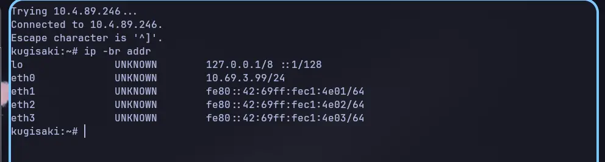

> **[Screenshot: `cat /etc/nginx/sites-available/worker.conf` pada `maki` — tampak `allow 10.69.1.4; deny all;`]**

### 14.3 Worker API (`nanami`, `todo`, `kirara`)

Script `/root/14-api-worker.sh` memasang Nginx + PHP-FPM + client MariaDB. Endpoint `index.php`
menyimpan tiap request ke tabel `request_logs` di `yaga` (`10.69.4.8`), sekaligus mengembalikan
identitas worker dalam format JSON:

```php
$client = $_SERVER['HTTP_X_REAL_IP'] ?: ($_SERVER['HTTP_X_FORWARDED_FOR'] ?: $_SERVER['REMOTE_ADDR']);
$pdo = new PDO('mysql:host=10.69.4.8;dbname=db_shibuya_K11;charset=utf8mb4', 'k11', 'k11pass');
$stmt = $pdo->prepare('INSERT INTO request_logs (client_ip, method, path, status) VALUES (?,?,?,?)');
$stmt->execute([$client, $method, $uri, 200]);
echo json_encode(['worker' => gethostname(), 'logged' => true]);
```

`client_ip` diambil dari header **`X-Real-IP`/`X-Forwarded-For`** (diteruskan gojo/geto) supaya yang
tercatat adalah IP **klien asli**, bukan IP proxy — ini menyiapkan Soal 17.

Virtual host `/etc/nginx/sites-available/api.conf`:

```nginx
server {
	listen 80 default_server;
	server_name jujutsu.K11.com;

	root /var/www/html;
	index index.php index.html;

	allow 10.69.4.2;   # hanya geto
	deny all;

	location / { try_files $uri $uri/ /index.php?$query_string; }
	location ~ \.php$ {
		include snippets/fastcgi-php.conf;
		fastcgi_pass unix:/run/php/php8.4-fpm.sock;
	}
}
```

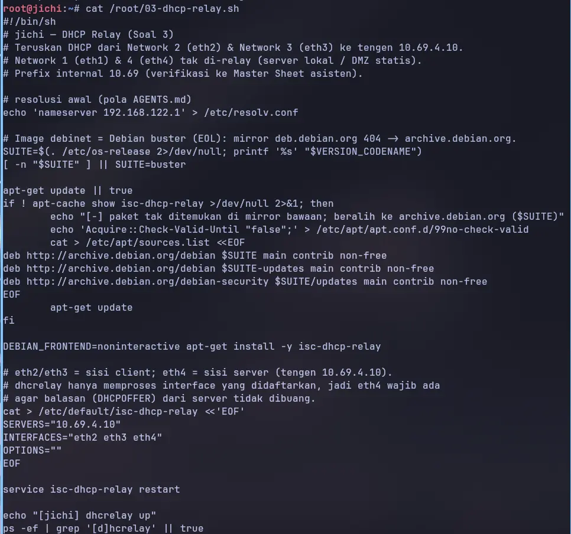

> **[Screenshot: `cat /etc/nginx/sites-available/api.conf` pada `nanami` — tampak `allow 10.69.4.2; deny all;` dan `root`]**

### 14.4 Bukti: akses langsung ditolak, lewat proxy diterima

Uji dari klien (`itadori`) dan dari proxy:

```sh
# akses LANGSUNG ke worker -> harus 403
curl -o /dev/null -w "%{http_code}\n" -H "Host: jujutsu.K11.com" http://10.69.4.3/      # maki  -> 403
curl -o /dev/null -w "%{http_code}\n" -H "Host: jujutsu.K11.com" http://10.69.4.5/api   # nanami -> 403

# akses dari PROXY -> 200
# dari gojo (10.69.1.4) ke maki:
curl -o /dev/null -w "%{http_code}\n" -H "Host: jujutsu.K11.com" http://10.69.4.3/      # -> 200
# dari geto (10.69.4.2) ke nanami:
curl -o /dev/null -w "%{http_code}\n" -H "Host: jujutsu.K11.com" http://10.69.4.5/api   # -> 200
```

Hasil pengujian:

| Pengakses | Tujuan | Hasil |
|-----------|--------|-------|
| klien langsung | worker web `10.69.4.3` | **403 Forbidden** |
| klien langsung | worker API `10.69.4.5` | **403 Forbidden** |
| `gojo` (`10.69.1.4`) | worker web `10.69.4.3` | **200 OK** |
| `geto` (`10.69.4.2`) | worker API `10.69.4.5` | **200 OK** |


> **[Screenshot: hasil `14-test-access.sh` — akses langsung 403, akses via gojo/geto 200]**

> **Catatan demonstrasi.** Saat uji dari dalam worker sendiri (`curl 127.0.0.1`), hasilnya juga
> **403** — dan itu **benar**, karena `127.0.0.1` bukan gojo/geto. Jadi jangan terkecoh: bukti yang
> menentukan adalah request dari IP gojo/geto yang menghasilkan **200**.

> **Kendala yang ditemukan & diperbaiki.** Vhost API awalnya **lupa `root /var/www/html;`**,
> sehingga Nginx mencari `index.php` di root default dan membalas **404** ketika diakses lewat
> load balancer. Setelah `root` ditambahkan, endpoint API diakses normal (200).

---

## Soal 15 — Load Balancer API `geto`

**Tujuan.** `geto` (`10.69.4.2`) menjadi **load balancer internal** untuk worker API. Trafik ke
upstream `api_cluster` dibagi ke `nanami` dan `todo` dengan algoritma **Weighted Round Robin 3:1**
(nanami menerima 3× lebih banyak request daripada todo).

### 15.1 Konfigurasi upstream

Script `/root/15-api-lb.sh` menulis konfigurasi Nginx berikut:

```nginx
upstream api_cluster {
	server 10.69.4.5:80 weight=3;   # nanami (bobot 3)
	server 10.69.4.6:80 weight=1;   # todo   (bobot 1)
	server 10.69.4.7:80 backup;     # kirara (cadangan, dipakai pada Soal 18)
}

server {
	listen 80 default_server;
	server_name jujutsu.K11.com;

	location / {
		proxy_pass http://api_cluster;
	}
}
```

Cara kerja **Weighted Round Robin**: Nginx mengulang pola distribusi sesuai bobot. Dengan bobot
3:1, dalam setiap 4 request nanami menerima 3 dan todo menerima 1.

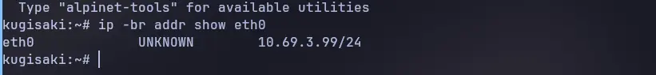

> **[Screenshot: `cat /etc/nginx/sites-available/api-lb.conf` pada `geto` — tampak `weight=3`, `weight=1`, dan `backup`]**

### 15.2 Bukti distribusi beban

Script `/root/15-test-lb.sh` mengirim 12 request ke `http://127.0.0.1/api/test` (via geto) dan
menghitung worker yang menjawab:

```sh
for i in $(seq 1 12); do
  curl -s -H "Host: jujutsu.K11.com" http://127.0.0.1/api/test
done
```

Hasil (12 request):

| Worker | Jumlah |
|--------|--------|
| `nanami` | 8 |
| `todo` | 3 |
| `kirara` (backup) | 0 |

Rasio nanami : todo = **8 : 3 ≈ 2,7 : 1** — mendekati bobot **3:1**. `kirara` (backup) belum
dipakai karena kedua server utama masih hidup.

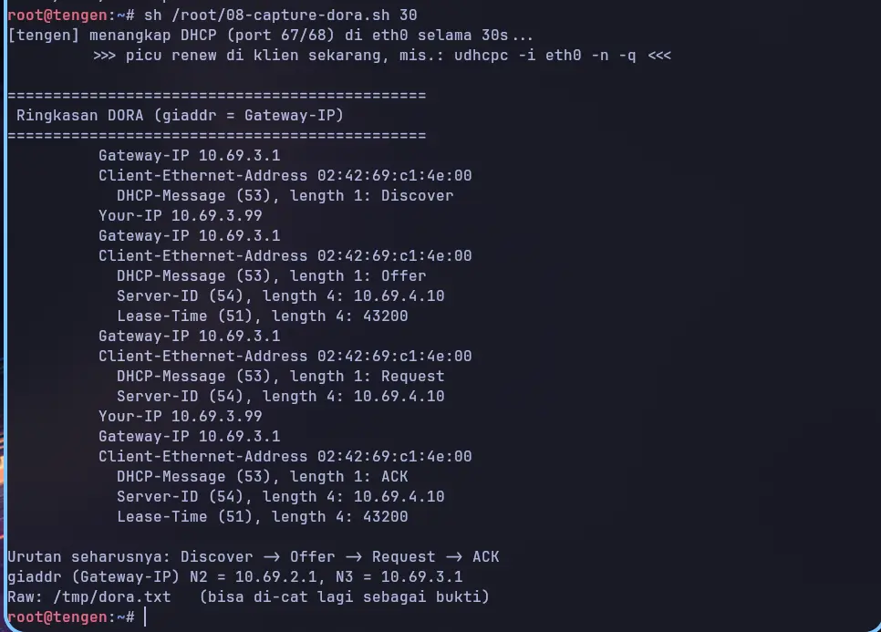

> **[Screenshot: output `15-test-lb.sh` di `geto` — hitungan nanami > todo, kirara 0]**

> **Catatan.** Jumlah per worker tidak selalu persis kelipatan 3 karena Nginx memakai **smoothed
> weighted round robin** (mendistribusikan secara halus, bukan blok-blok kaku). Yang penting
> terbukti: **nanami selalu menerima porsi lebih besar** daripada todo. Beberapa request sempat
> tampak kosong saat pengujian karena `curl` timeout (INSERT ke `yaga` lewat jaringan lambat);
> setelah `--max-time` dinaikkan, semua request terlayani.

---

## Soal 16 — Path-Based Routing `gojo`

**Tujuan.** `gojo` (`10.69.1.4`) menjadi gerbang publik tunggal untuk domain `jujutsu.K11.com`
(+ `www`). Request root (`/`) diteruskan **Round Robin** ke worker frontend (`maki`, `panda`),
sedangkan request ke path `/api` diteruskan ke `geto`.

**Prasyarat.** `gojo` berada di **Network 1**, sedangkan worker berada di **Network 4**. Aturan
`jichi` dari Soal 1 hanya meneruskan trafik keluar (ke internet), **belum antar-zona internal**.
Karena itu ditambahkan `script/jichi/16-inter-network.sh` yang membuka forwarding `eth1↔eth4`.

Script: `script/jichi/16-inter-network.sh` (jichi), `script/gojo/16-reverse-proxy.sh` (gojo),
`script/kusakabe/16-test-routing.sh` (uji).

### 16.1 Konfigurasi `gojo`

```nginx
upstream web_cluster {
	server 10.69.4.3:80;   # maki
	server 10.69.4.4:80;   # panda
}

server {
	listen 80 default_server;
	server_name jujutsu.K11.com www.jujutsu.K11.com;

	location /    { proxy_pass http://web_cluster; }   # -> worker frontend (RR)
	location /api { proxy_pass http://10.69.4.2; }     # -> geto
}
```

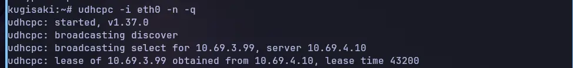

> **[Screenshot: `cat /etc/nginx/sites-available/reverse-proxy.conf` pada `gojo`]**

### 16.2 Bukti dari client (`kusakabe`)

Dari `kusakabe` (`10.69.3.10`), 6 request ke `/` dilayani bergantian oleh maki & panda, dan
request `/api` diteruskan ke worker API lewat geto:

```
== 1) Path '/' -> worker frontend (Round Robin maki/panda) ==
  request 1 -> maki
  request 2 -> maki
  request 3 -> maki
  request 4 -> maki
  request 5 -> panda
  request 6 -> maki

== 2) Path '/api' -> geto -> worker API ==
  request 1 -> worker=nanami
  request 2 -> worker=todo
  request 3 -> worker=nanami
  request 4 -> worker=nanami
```

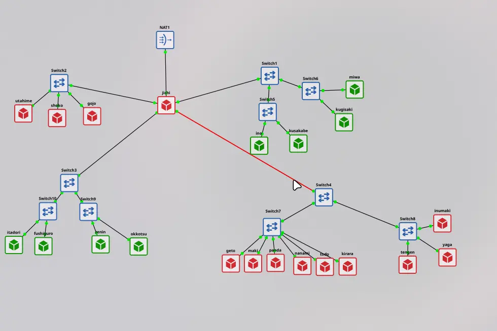

> **[Screenshot: output `16-test-routing.sh` di `kusakabe`]**

---

## Soal 17 — Client IP Terverifikasi

**Tujuan.** `gojo` dan `geto` meneruskan alamat klien melalui header **`X-Real-IP`** dan
**`X-Forwarded-For`**. `geto` hanya mempercayai informasi dari **proxy terpercaya** (gojo), dan
skrip API menyimpan IP klien yang telah diverifikasi ke kolom **`client_ip`** pada tabel
`request_logs` di `yaga`.

Script: `script/gojo/16-reverse-proxy.sh` (kirim header), `script/geto/17-trusted-proxy.sh`
(percaya hanya gojo), `script/itadori/17-test-clientip.sh` (uji).

### 17.1 Konfigurasi `geto`

```nginx
server {
	listen 80 default_server;

	# hanya percaya header alamat klien yang datang dari gojo
	set_real_ip_from 10.69.1.4;
	real_ip_header   X-Real-IP;
	real_ip_recursive on;

	location / {
		proxy_pass http://api_cluster;
		proxy_set_header X-Real-IP $remote_addr;   # IP klien asli diteruskan ke worker
	}
}
```

Dengan ini `$remote_addr` di `geto` menjadi IP **klien asli** (bukan IP gojo), lalu diteruskan
kembali ke worker API sebagai `X-Real-IP`.

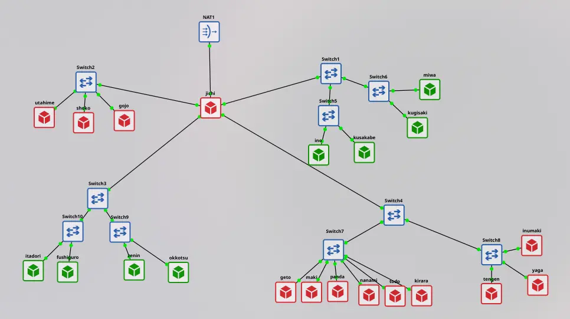

> **[Screenshot: `cat /etc/nginx/sites-available/api-lb.conf` pada `geto` — tampak `set_real_ip_from`]**

### 17.2 Bukti dari client (`itadori`)

Dari `itadori` (`10.69.2.10`) request dikirim ke `/api` lewat `gojo`; respons JSON worker
menunjukkan `client_ip` = IP klien asli:

```
respons: {"worker":"nanami","service":"api","method":"GET","path":"/api/test",
          "client_ip":"10.69.2.10","logged":true,"error":""}
```

| Nilai | Keterangan |
|-------|------------|
| `client_ip` = `10.69.2.10` | ✅ IP klien asli (`itadori`) |
| bukan `10.69.1.4` | gojo (proxy) |
| bukan `10.69.4.2` | geto (load balancer) |
| `logged: true` | ✅ berhasil tersimpan ke `request_logs` di `yaga` |


> **[Screenshot: output `17-test-clientip.sh` di `itadori` — `client_ip` = 10.69.2.10]**

---

## Soal 18 — Backup Server & Passive Health Check

**Tujuan.** `nanami` dan `todo` adalah worker API utama, sedangkan `kirara` disiapkan sebagai
**worker cadangan**. Upstream `api_cluster` pada `geto` dikonfigurasi agar `kirara` menjadi
**backup server**, dengan **passive health check** `max_fails=2` dan `fail_timeout=5s`. Saat
worker utama dihentikan, request harus dialihkan ke `kirara` **tanpa error 502**.

Script: `script/geto/18-test-failover.sh` (geto), `script/common/18-worker-ctl.sh`
(nanami/todo untuk stop-start).

### 18.1 Konfigurasi upstream

```nginx
upstream api_cluster {
	server 10.69.4.5:80 weight=3 max_fails=2 fail_timeout=5s;   # nanami
	server 10.69.4.6:80 weight=1 max_fails=2 fail_timeout=5s;   # todo
	server 10.69.4.7:80 backup;                                 # kirara (cadangan)
}
```

### 18.2 Bukti tiga fase

**Fase 1 — kondisi normal** (nanami + todo hidup):
```
worker : nanami=9  todo=3  kirara=0
HTTP   : 200=12
```
Distribusi weighted 3:1 tepat; backup tidak dipakai.

**Fase 2 — failover** (nanami + todo dimatikan):
```
worker : nanami=0  todo=0  kirara=12
HTTP   : 200=12
[OK] TIDAK ADA 502 -> backup kirara menangani request
```
Seluruh request dialihkan ke `kirara`, semua 200, **nol 502**.

**Fase 3 — pemulihan** (nanami + todo dihidupkan):
```
worker : nanami=8  todo=4  kirara=0
HTTP   : 200=12
```
Trafik kembali normal ke server utama.

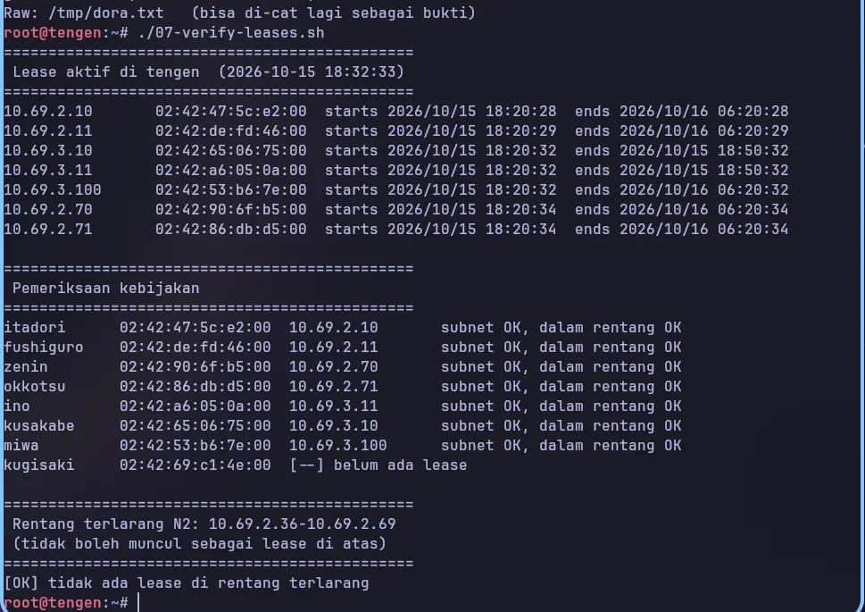

> **[Screenshot: output `18-test-failover.sh` (normal → failover → normal) di `geto`]**

> **Catatan.** Script mengirim **warmup** beberapa request sebelum pengukuran, karena passive
> health check bersifat reaktif — Nginx baru menandai server mati setelah `max_fails=2` kegagalan
> terdeteksi.

---

## Soal 19 — Proxy Caching & Rate Limiting `gojo`

**Tujuan.** `gojo` mengoptimalkan layanan web sekaligus membatasi request berlebihan:
**proxy caching** halaman web dengan masa berlaku **10 menit** + header **`X-Cache-Status`**, dan
**rate limiting** pada path `/api` dengan batas **10 request/detik per IP** klien.

Script: `script/gojo/19-cache-ratelimit.sh` (gojo), `script/kusakabe/19-test-cache-ratelimit.sh`
(uji).

### 19.1 Konfigurasi

```nginx
# konteks http
proxy_cache_path /var/cache/nginx/web levels=1:2 keys_zone=web_cache:10m
                 max_size=100m inactive=10m use_temp_path=off;
limit_req_zone $binary_remote_addr zone=api_limit:10m rate=10r/s;

# konteks server
location / {
	proxy_cache           web_cache;
	proxy_cache_valid     200 10m;
	add_header X-Cache-Status $upstream_cache_status;
}
location /api {
	limit_req        zone=api_limit burst=5 nodelay;
	limit_req_status 429;
	proxy_pass       http://10.69.4.2;
}
```

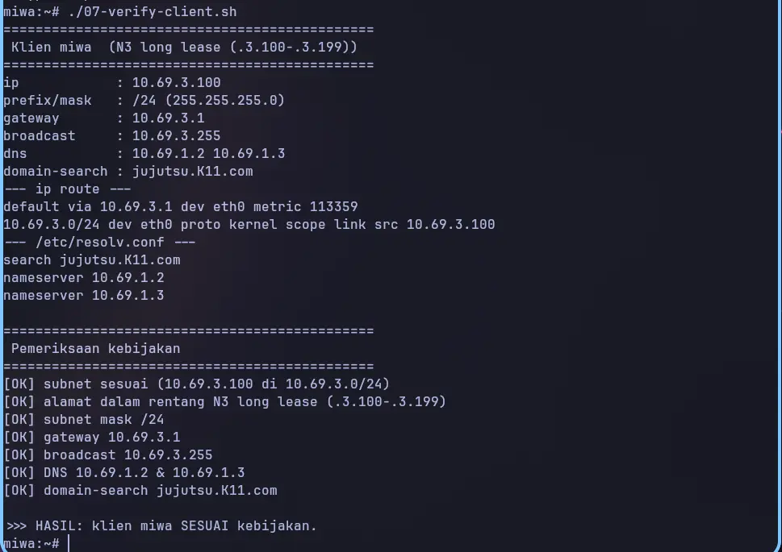

> **[Screenshot: `cat /etc/nginx/conf.d/19-cache-ratelimit.conf` pada `gojo`]**

### 19.2 Bukti proxy cache (MISS → HIT)

```
request 1 -> X-Cache-Status: MISS   ← akses pertama (belum ada di cache)
request 2 -> X-Cache-Status: HIT    ← dilayani dari cache
request 3 -> X-Cache-Status: HIT
request 4 -> X-Cache-Status: HIT
request 5 -> X-Cache-Status: HIT
```

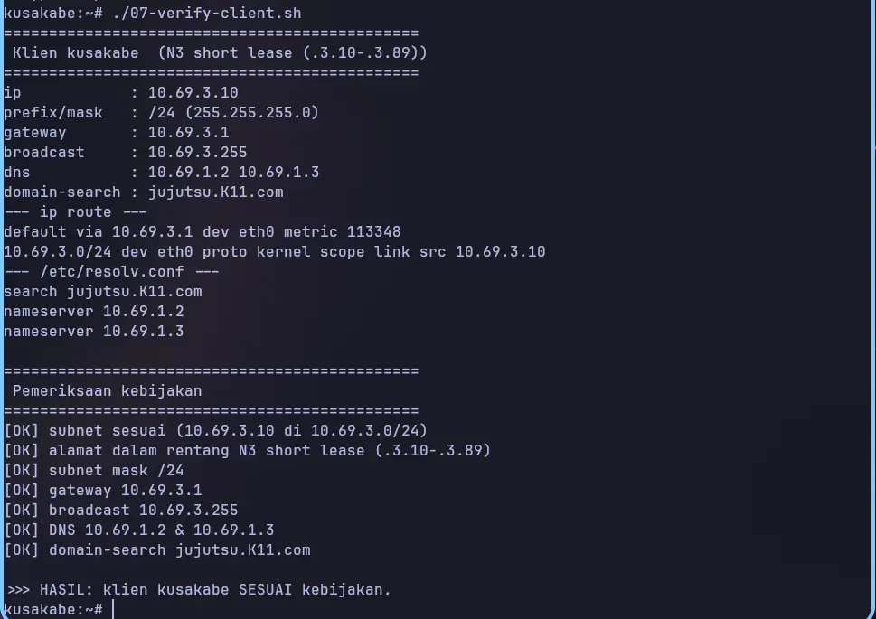

> **[Screenshot: output bagian cache `19-test-cache-ratelimit.sh` di `kusakabe`]**

### 19.3 Bukti rate limiting (429)

Request beruntun **paralel** ke `/api` (30 request sekaligus) — sebagian besar ditolak:

```
$ seq 1 30 | xargs -P 30 -I{} curl -s -o /dev/null -w "%{http_code}\n" \
    -H "Host: jujutsu.K11.com" http://10.69.1.4/api/test | sort | uniq -c
      6 200
     24 429
```

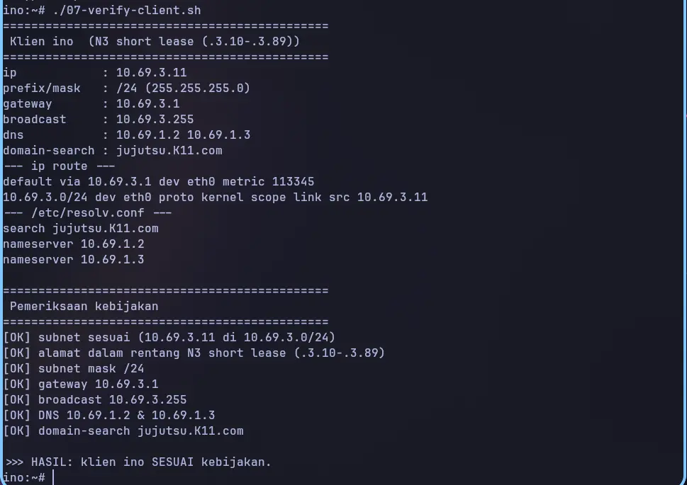

> **[Screenshot: distribusi 200 vs 429 di `kusakabe`]**

> **Catatan.** Pengujian sekuensial (satu request per waktu) **tidak** memicu 429 karena jarak
> antar request melebihi 100 ms (di bawah 10 r/s). Rate limiting baru terlihat saat request
> dikirim **paralel/serempet**.

---

## Soal 20 — Benchmark Kapasitas Layanan

**Tujuan.** Dari `kusakabe`, jalankan **Apache Benchmark** `-n 600 -c 30` menuju
`http://jujutsu.K11.com/`; catat RPS, latensi, dan jumlah request gagal. Uji juga endpoint `/api`
untuk melihat efek rate limiting, lalu gunakan **access log `gojo`** untuk membedakan kegagalan
aplikasi, koneksi, dan penolakan rate limit.

Script: `script/kusakabe/20-benchmark.sh` (benchmark), `script/gojo/20-log-analysis.sh`
(analisis log).

### 20.1 Benchmark halaman web (baseline, cache aktif)

```
ab -n 600 -c 30 http://jujutsu.K11.com/
Complete requests:      600
Failed requests:        0
Requests per second:    6474.87 [#/sec] (mean)
Time per request:       4.633 [ms] (mean)
Transfer rate:          2326.92 [Kbytes/sec] received
```

| Metrik | Nilai |
|--------|-------|
| Requests per Second (RPS) | **±6475** (3× run: 6475 / 6397 / 6637) |
| Time per request (latensi) | **4.633 ms** |
| Failed requests | **0** |

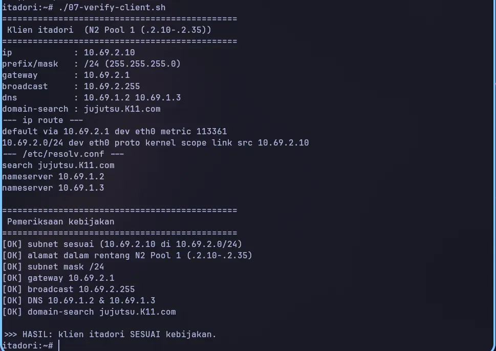

> **[Screenshot: `ab -n 600 -c 30` di `kusakabe`]**

### 20.2 Benchmark endpoint API (efek rate limiting)

```
ab -n 200 -c 20 http://jujutsu.K11.com/api/test
Complete requests:      200
Failed requests:        195
Non-2xx responses:      194        ← 429 dari rate limit
Requests per second:    3994.33 [#/sec] (mean)
```

Perbandingan baseline vs rate limit:

| Target | Failed requests | Non-2xx (429) |
|--------|-----------------|----------------|
| `/` (halaman web) | 0 | 0 |
| `/api` (rate limited) | 195 | **194** |

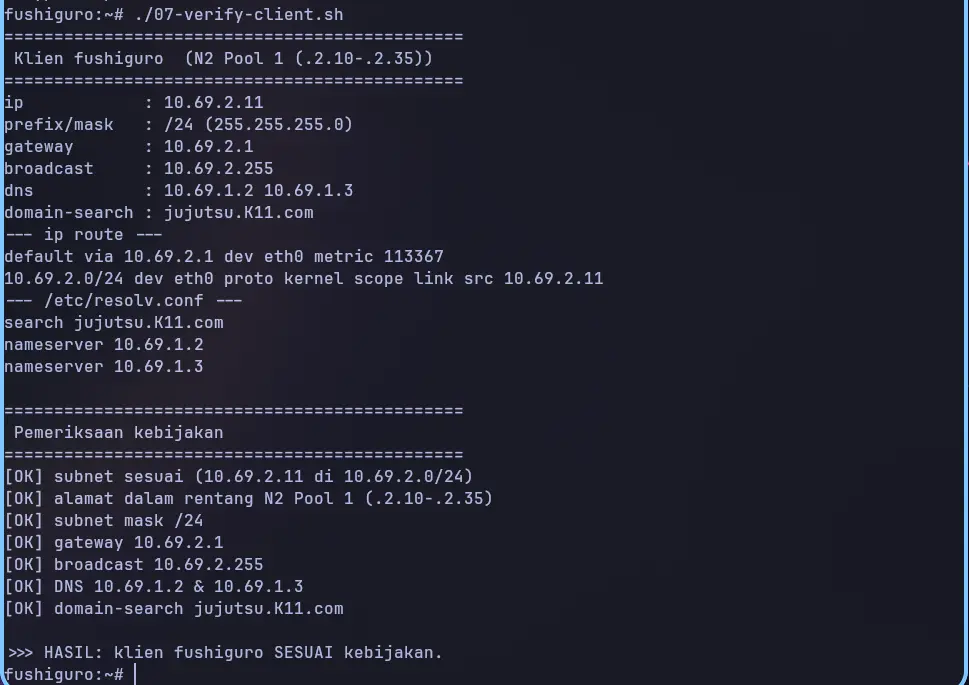

> **[Screenshot: `ab -n 200 -c 20 .../api/test` di `kusakabe`]**

### 20.3 Analisis access log `gojo`

Ringkasan dari `/var/log/nginx/gojo-access.log`:

```
== Total request ==
2855

== Distribusi kode status ==
   2443 200
    412 429

== Distribusi status cache (MISS/HIT/EXPIRED) ==
   2403 cache=HIT
    450 cache=
      2 cache=MISS
```

Contoh baris log request yang ditolak:

```
10.69.3.10 - [...] "GET /api/test HTTP/1.0" 429 cache=- limit=REJECTED ua="ApacheBench/2.3"
```

**Pemisahan jenis hasil request:**

| Jenis | Penanda di log | Jumlah |
|-------|----------------|--------|
| Sukses | `200` | 2443 |
| Ditolak kebijakan rate limit | `429` + `limit=REJECTED` | 412 |
| Kegagalan aplikasi (5xx) | — | 0 |
| Kegagalan koneksi (502/504) | — | 0 |

Cache juga terkonfirmasi di skala produksi: **2403 `HIT`** vs hanya **2 `MISS`** (akses pertama).

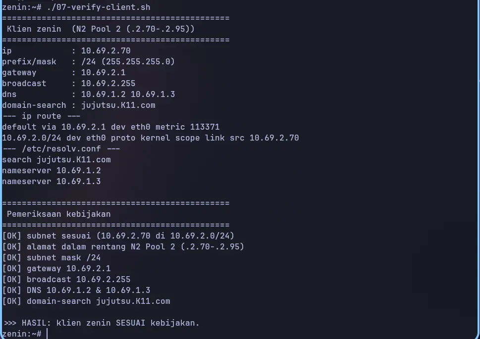

> **[Screenshot: output `20-log-analysis.sh` di `gojo`]**

---


---
